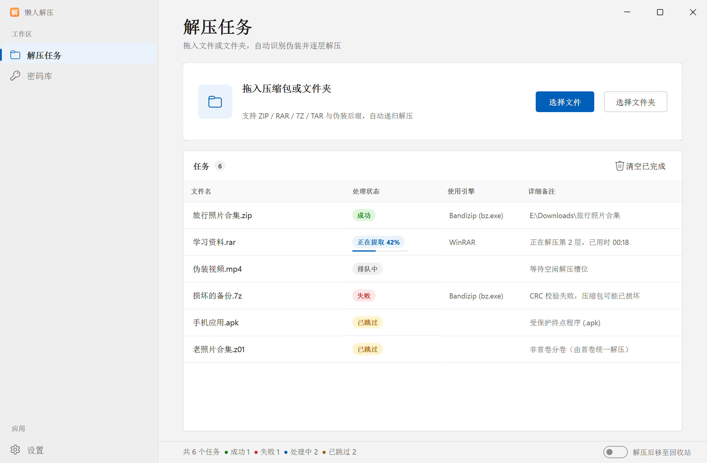
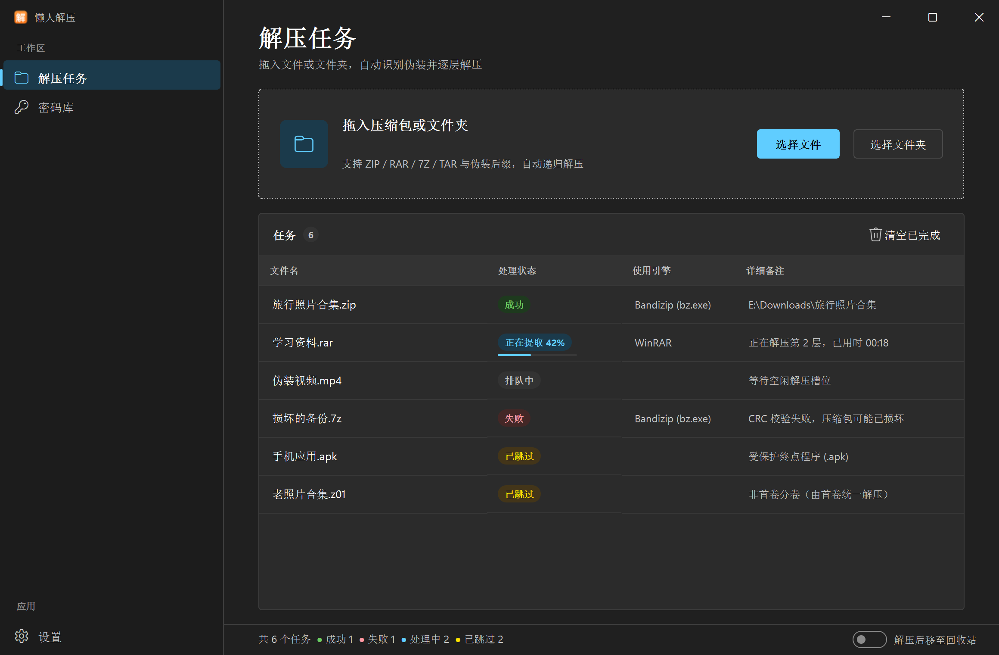
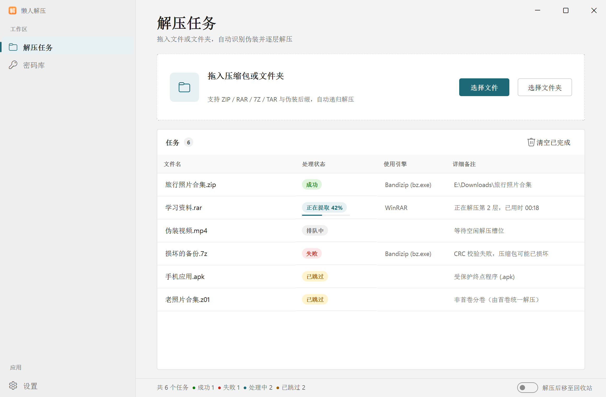
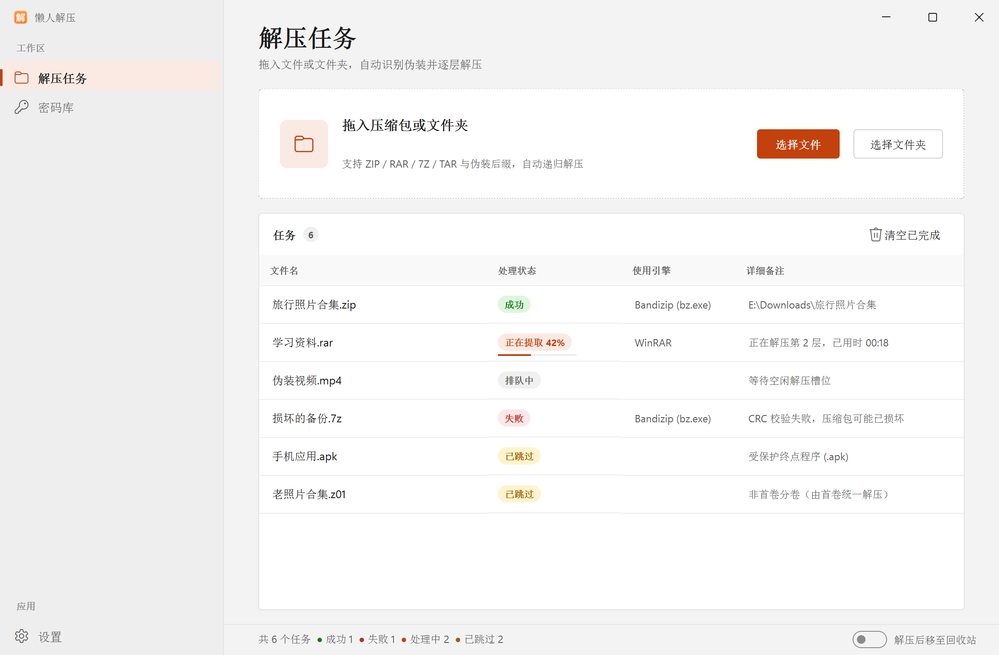
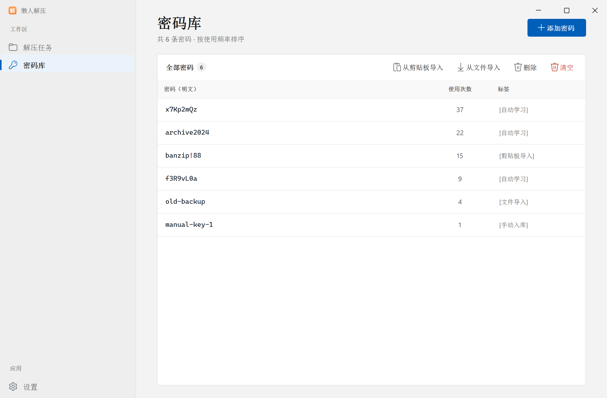
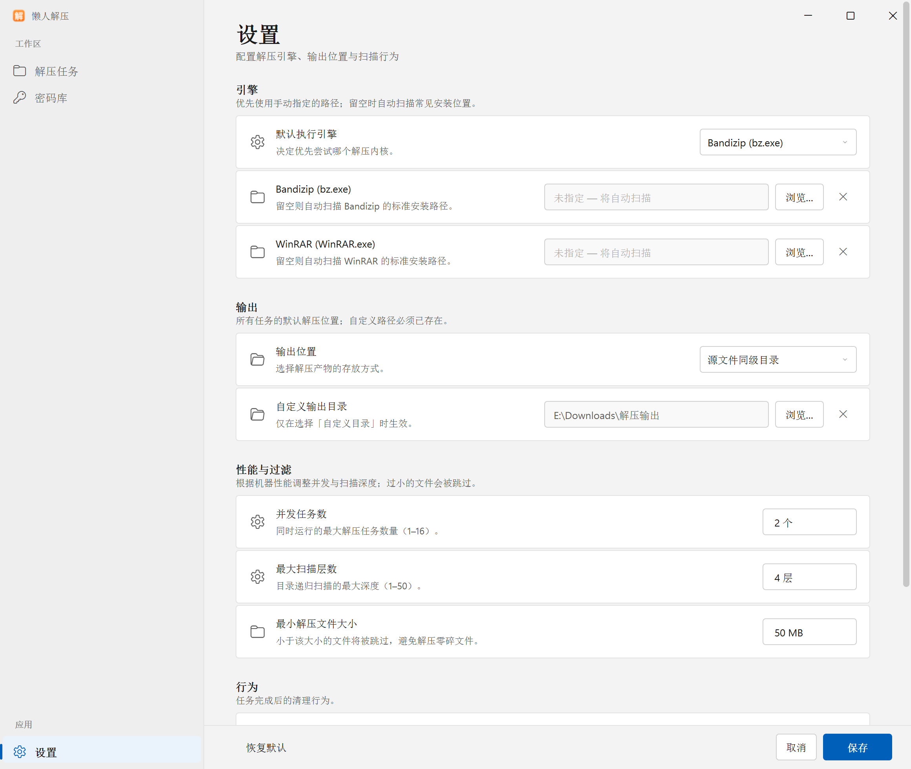
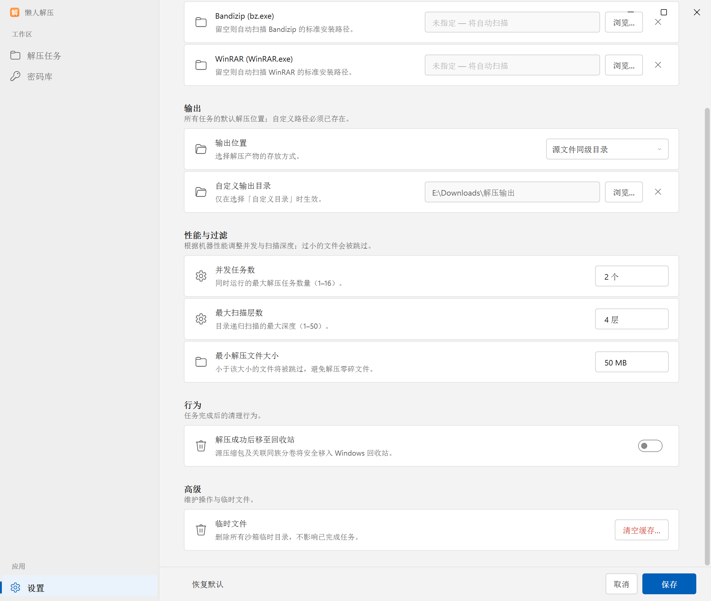
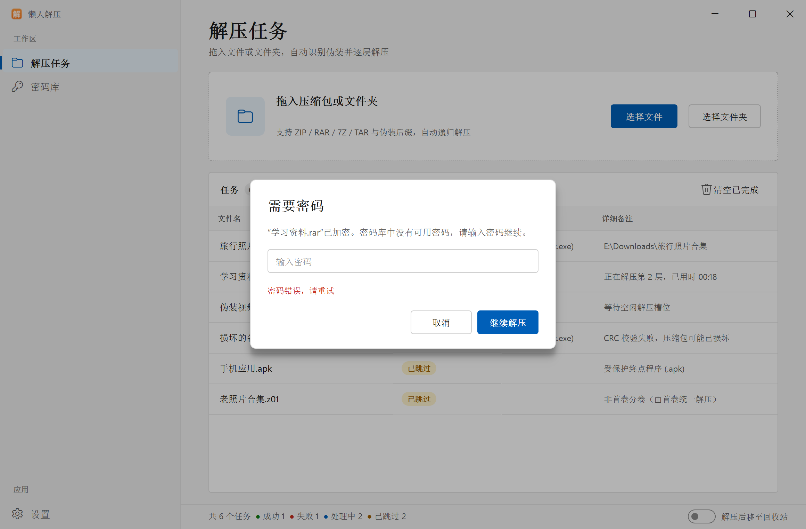
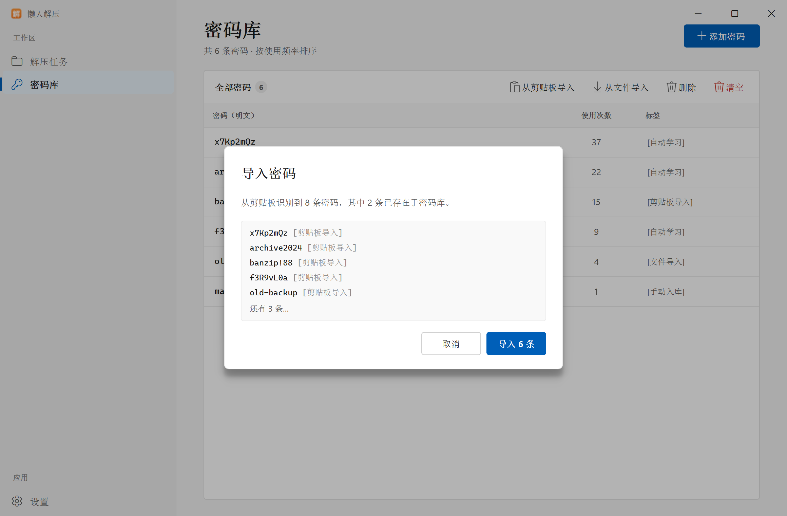

# 懒人解压 UI 重构规划

> 方向：Microsoft Fluent / WinUI 3，参考 PowerToys 与 Magpie 的桌面工具界面  
> 状态：**仅规划与设计稿，生产 UI 代码未改动**  
> 版本基线：ShellBreaker 1.0.6（`pyproject.toml`）  
> 设计稿：`docs/mockups/fluent_prototype.py`（独立静态原型，假数据，不依赖项目核心代码）  
> 截图目录：`docs/mockups/out/`

---

## 0. 一页结论

### 建议方案

把当前“一个主窗口 + 两个模态对话框”的结构，重构为 **NavigationView 导航壳 + 三个页面 + 统一 ContentDialog**：

```
懒人解压
├─ 解压任务（默认页）
├─ 密码库
└─ 设置
```

- **解压任务**：拖放卡片 + 任务表格 + 底部状态栏。所有现有任务操作原样保留。
- **密码库**：由模态对话框改为页面；三列表格、添加/剪贴板导入/文件导入/删除/清空全部保留。
- **设置**：由模态对话框改为页面；引擎、输出、性能、行为、高级五组 SettingsCard；底部“取消 / 保存”。
- **对话框**：只保留密码输入、导入预览、危险操作确认三类；其余结果反馈改为页内 InfoBar。
- **标题栏**：目标为 40px 自绘标题栏（PowerToys/Magpie 风格）；实现分两步，先保留原生标题栏，页面稳定后再切换自绘，避免一开始就陷入 Win32 命中测试。
- **主题**：浅色为基线；深色和“跟随系统强调色”作为可选项，设计稿已经验证。

### 需要你拍板的事（推荐项已标出）

| # | 决策 | 推荐 |
|---|---|---|
| 1 | 密码库/设置是否改成页面？ | **是**，页面 + 保留旧对话框类做兼容包装 |
| 2 | 强调色用哪个？ | **跟随系统强调色**（本机为青绿 `#1D6978`）；品牌橙 `#C2410C` 作为备选 |
| 3 | 标题栏现在就自绘吗？ | **先原生，后自绘**；页面稳定后再做 40px 标题栏 |
| 4 | 这轮是否包含深色主题？ | **建议包含**，但可放到第二阶段；浅色先验收 |
| 5 | “一键清空缓存”放哪？ | **设置 › 高级** 为主，任务页“更多”菜单保留一个入口 |
| 6 | 设置保存方式？ | **显式“保存/取消”**，保持现有语义；离开未保存时提示 |
| 7 | 默认窗口尺寸？ | **1160×760，最小 900×600**；导航在 <920px 时收成 48px 图标栏 |
| 8 | 是否加“关于”页？ | **这轮不加**；没有现成功能，避免虚构入口 |

### 设计稿预览

浅色任务页（Windows 默认蓝强调色）：



深色任务页：



本机系统强调色（青绿）与品牌橙对比：





---

## 1. 目标、范围与边界

### 1.1 目标

1. 让界面在视觉语言上接近 Microsoft 桌面工具：NavigationView、SettingsCard、ContentDialog、Segoe Fluent Icons、系统强调色、清晰的状态层级。
2. 重新组织信息架构：把“设置/密码管理”从模态对话框提升为页面，减少“打开对话框—操作—关闭”的打断。
3. 保留现有全部功能、按钮、快捷操作、状态文案和后端接口；只改变布局、入口、视觉和交互呈现。
4. 建立可维护的设计系统：颜色/字号/间距/图标 token 化，替换 385 行硬编码 QSS。
5. 让测试仍能按原方式实例化 `MainWindow`、`SettingsDialog`、`PasswordDialog`，尽量不改现有测试。

### 1.2 包含

- 窗口壳、标题栏、左侧导航、页面切换、响应式断点。
- 任务页布局、拖放区、表格、状态栏、空状态、右键菜单、双击定位。
- 密码库页面、导入/添加/删除/清空对话框。
- 设置页面、路径选择、数字输入、开关、保存/取消、校验提示。
- 统一对话框与页内通知（InfoBar）。
- 浅色/深色 token，系统强调色适配。
- 键盘操作、焦点可见性、DPI 适配。
- 现有 UI 测试的兼容层与新增 UI 冒烟测试。

### 1.3 不包含

- 不改 `core/` 的解压、扫描、密码学习、并发、沙箱逻辑。
- 不改 `TaskQueue` 信号签名、状态词表、配置键语义。
- 不新增“暂停/取消任务”“任务搜索”“密码搜索”“导出日志”“自动更新”等当前不存在的功能。
- 不重写 `QTableWidget` 为 model/view；现有测试直接依赖 `QTableWidget` API。
- 不更换应用图标（橙色“解压”图标保留；只调整使用尺寸和位置）。
- 不首发就强上 Mica/亚克力；先保证稳定和可读性。

### 1.4 成功标准

- [ ] 现有 `tests/` 全部通过，理想情况下**零修改**。
- [ ] 第 7 节功能映射表逐项签字，没有按钮/菜单/状态丢失。
- [ ] 1160×760、900×600、1920×1080、150%/200% DPI 下无遮挡、无横向溢出。
- [ ] 纯键盘可完成：选文件、选目录、切页、清空、打开右键菜单、确认对话框。
- [ ] 浅色与深色下文字对比度达到 WCAG AA（正文 ≥ 4.5:1，大字号 ≥ 3:1）。
- [ ] 任务运行中打开设置/密码库/密码输入框不阻塞队列；关闭窗口仍能 `shutdown(wait=False)`。
- [ ] 首次启动、空列表、扫描中、解压中、失败、跳过、全部完成都有明确状态。

---

## 2. 现状审计

### 2.1 现有屏幕与入口

| 屏幕 | 入口 | 主要内容 | 现状截图 |
|---|---|---|---|
| 主窗口 | 启动 | 拖放区、任务看板、统计栏、底部三个大按钮 | `mockups/out/before_tasks.png` |
| 全局设置 | 底部“⚙️ 全局设置” | 4 个 GroupBox：引擎路径、默认引擎、输出路径、性能与过滤 | `mockups/out/before_settings.png` |
| 密码管理 | 底部“🔑 密码管理” | 3 列表格 + 两行按钮 | `.ui-plan/baseline/password_dialog.png` |
| 密码输入 | 任务需要密码 | `QInputDialog.getText`，取消即跳过 | 无独立截图 |
| 密码错误 | 密码错误 | `QMessageBox.warning` + 再次 `QInputDialog` | 无独立截图 |
| 确认/结果 | 清缓存等 | `QMessageBox.question/information/warning` | 无独立截图 |

### 2.2 现有界面的主要问题

**视觉层**

- 橙色卡片 + emoji 图标（📦📂📁📋📊🗑️🧹🔑⚙️）是“暖心快递箱”风格，不是 Microsoft Fluent；emoji 在不同 Windows 版本/字体下字形不一致。
- 主界面底部三个等宽大按钮（清缓存/密码管理/全局设置）把“维护/导航”做成了主操作，视觉权重高于任务本身。
- 表格状态只用文字着色，失败/跳过/排队在长列表中不够容易扫读；没有状态胶囊、没有进度条。
- 表头默认居中，与左对齐的文件名/备注不协调。
- 没有空状态；没有焦点环；没有深色模式；没有 hover/pressed 的完整状态。

**信息架构层**

- 设置和密码库是模态对话框：打开时不能看任务进度；设置窗口 580×620，内容被滚动区截断，底部按钮固定但上半部分拥挤。
- 密码错误流程是“警告框 → 重新弹输入框”，两次模态切换，打断感强。
- 导入预览用 `QMessageBox` 纯文本，只显示前 5 条，长密码/标签不易读。
- “一键清空缓存”和“清空已完成”都在底部，危险操作与普通操作混在一起。

**工程层**

- `assets/style.qss` 385 行，颜色/圆角/字号全部硬编码，没有 token；换主题或调一处颜色需要全局搜索。
- QSS 只在 `main.py` 启动时加载。测试直接 `MainWindow()` 时不会经过 `main.py`，因此**新主题必须在 `MainWindow` 内部也应用**，不能只改入口。
- 状态色 `STATUS_COLORS` 在 `ui/main_window.py:50-58` 另有一份，和 QSS 重复。
- `SettingsDialog` 的“解压后删除源文件”和主窗口快捷勾选是两份控件，靠对话框 `exec()` 返回后同步；改成常驻页面后必须重新设计同步方式。
- `disguise_min_size_mb` 在 `ConfigManager.DEFAULT_CONFIG` 中存在、`core/pipeline.py:513` 使用，但设置界面从未暴露；这是**已有配置项，不是新接口**，但本轮不建议擅自加 UI（见 6.3）。

### 2.3 当前文件与职责

| 文件 | 行数/大小 | 职责 | 重构后 |
|---|---:|---|---|
| `main.py` | 123 行 | 日志、excepthook、HighDPI、加载 QSS/图标、启动 MainWindow | 保留；QSS 加载改为主题管理器；崩溃对话框保留原生 |
| `ui/main_window.py` | 785 行 / 33 KB | 窗口、拖放、表格、右键菜单、统计、密码弹窗、清缓存 | 拆为壳 + 任务页 + 控制器；保留兼容属性 |
| `ui/settings_dialog.py` | 271 行 / 11 KB | 4 组设置 + 保存校验 | 包装 `SettingsPage`；保留 `_cb_delete_source`、`_on_save` |
| `ui/password_dialog.py` | 281 行 / 10 KB | 密码表格 + 5 个动作 | 包装 `PasswordPage`；保留 5 个按钮和 3 列表头 |
| `assets/style.qss` | 385 行 | 全部视觉 | 由 token 生成 QSS；旧文件删除或仅作回退 |
| `assets/app_icon.png/.ico` | 256×256 / 多尺寸 | 应用图标 | 保留，标题栏 16px、导航/关于 32px 使用 |

### 2.4 测试对 UI 的硬耦合（必须兼容）

`tests/test_feature_updates.py:585-746` 的 `TestFeatureUIComponents` 直接访问以下成员：

- `MainWindow()._table`、`_task_rows`、`_task_data`、`_cb_delete_source`
- `MainWindow._on_task_status_changed(...)`、`dropEvent(event)`、`_on_drop_paths_ready`
- 表格 `item(row, 0/1/3).text()` 的精确文案
- `SettingsDialog()._cb_delete_source.isChecked/setChecked`、`_on_save()`
- `PasswordDialog()._table.columnCount() == 3`
- 表头精确为 `"密码（明文）"`、`"使用次数"`、`"标签"`
- `_btn_add`、`_btn_import_clip`、`_btn_import_file`、`_btn_delete`、`_btn_clear` 非空
- `_refresh_table()`

**策略：现有测试零修改优先。** `MainWindow` 保留这些属性名并指向新页面内的真实控件；`SettingsDialog`/`PasswordDialog` 保留为薄包装类，内部嵌入新页面并代理属性/方法。新增测试单独放 `tests/test_ui_*.py`。

---

## 3. 设计参考与取舍

### 3.1 参考对象

- **Microsoft WinUI 3 / Fluent**：NavigationView、SettingsCard、ContentDialog、InfoBar、ToggleSwitch、NumberBox、Segoe Fluent Icons、系统强调色。  
  <https://learn.microsoft.com/windows/apps/design/>
- **PowerToys Settings**：左侧导航 + 右侧设置卡片的桌面工具范式；设置项按功能分组，卡片标题+说明+右侧控件。  
  <https://github.com/microsoft/PowerToys>
- **Magpie**：本项目最接近的参考。40px 自绘标题栏、260px 导航、页面最大宽度 1000、28px 页面标题、68px SettingsCard、卡片间距 2px。  
  <https://github.com/Blinue/Magpie>

### 3.2 从 Magpie/PowerToys 借用的具体数值

从 Magpie 的 XAML 资源中核对到的值（用于设计稿，不是项目现有 API）：

- 标题栏高 40，左内边距 16，图标 16，标题 12px，右侧 caption 按钮。
- NavigationView 展开阈值 920；当前实现可简化为 260px 展开 / 48px 紧凑两档。
- 页面内容最大宽度 1000，页头 `Margin="40,54,40,16"`，标题 28px SemiBold。
- SettingsCard 最小高 68，内边距 16，边框 1px，圆角使用 `ControlCornerRadius`（4px）。
- SettingsGroup 标题 BodyStrong，说明 Caption 次要色，卡片之间 2px；组与组之间留 24–32px。
- 内容区与导航之间 1px 分隔线。

### 3.3 不照搬的部分

- 不照搬 Magpie 的“缩放模式/配置文件”导航结构；本项目只有任务、密码、设置。
- 不照搬 PowerToys 的模块列表/仪表盘；本项目没有模块概念。
- 不为了“像 Microsoft”而加搜索框、账户、更新、关于等不存在的功能。
- 不首发强上 Mica：Qt Widgets 的半透明/亚克力合成容易出渲染问题；先用实色 Fluent 背景，Mica 作为后续增强。

---

## 4. 目标信息架构

### 4.1 导航结构

```
┌ 标题栏 40px ─────────────────────────────────────────────┐
│ [图标] 懒人解压                                  —  □  × │
├──────────────┬───────────────────────────────────────────┤
│ 工作区        │  页面内容（最大宽 1000，左右 40）           │
│ ▍解压任务     │                                           │
│  密码库       │                                           │
│              │                                           │
│ 应用          │                                           │
│  设置         │                                           │
└──────────────┴───────────────────────────────────────────┘
```

- **解压任务**：唯一默认页；启动后直接进入。
- **密码库**：从原底部“密码管理”迁移；不再以模态挡住任务。
- **设置**：从原底部“全局设置”迁移；保存/取消在页面底部。
- **不做“关于”页**：当前没有关于信息/版本 API 的界面需求，避免虚构入口。版本号可放在设置页底部小字（可选，不属于功能）。

### 4.2 页面职责

| 页面 | 负责 | 不负责 |
|---|---|---|
| 解压任务 | 接收文件/目录、任务表格、状态、统计、清空已完成、右键操作、删除源开关 | 引擎路径、输出路径、并发等配置 |
| 密码库 | 密码列表、添加、导入、删除、清空 | 任务密码输入（运行中弹 ContentDialog） |
| 设置 | 引擎路径/默认引擎/输出/性能/行为/高级维护 | 任务操作 |

### 4.3 对话框与页内反馈

| 类型 | 使用场景 | 形式 |
|---|---|---|
| 密码输入 | 任务需要密码/密码错误 | ContentDialog（可重试，取消=跳过） |
| 导入预览 | 剪贴板/文件导入密码 | ContentDialog（前 5 条 + 总数 + 重复数） |
| 危险确认 | 清空缓存、删除选中密码、清空密码库 | ContentDialog，默认焦点在“取消” |
| 页内通知 | 保存成功、清缓存结果、导入结果、路径错误 | InfoBar（页顶，成功 5s 自动消失，错误需手动关） |
| 崩溃 | 未捕获异常 | 保留原生 `QMessageBox.critical`；不依赖主题 |

---

## 5. 设计系统

### 5.1 颜色 token

浅色基线（设计稿使用）：

| Token | 值 | 用途 |
|---|---|---|
| `window` | `#F3F3F3` | 窗口/内容底色 |
| `nav` | `#EEEEEE` | 导航底色 |
| `card` | `#FFFFFF` | 卡片/表格/对话框 |
| `card_border` | `#E3E3E3` | 卡片 1px 边框 |
| `text` | `#1A1A1A` | 主文字 |
| `text2` | `#5D5D5D` | 次要文字/说明 |
| `text3` | `#8A8A8A` | 占位/禁用/弱提示 |
| `accent` | `#005FB8`（或系统色） | 主按钮/选中/进度/焦点 |
| `accent_hover` | `#1A6FC4` | 主按钮 hover |
| `accent_pressed` | `#004C94` | 主按钮 pressed |
| `accent_tint` | `#EAF3FB` | 选中底色/图标底 |
| `control` | `#FFFFFF` | 输入/次级按钮 |
| `control_border` | `#D1D1D1` | 控件边框 |
| `control_hover` | `#F9F9F9` | hover/表头/只读底 |
| `divider` | `#EDEDED` | 分隔线/行线 |
| `selection` | `#EFF6FC` | 表格选中行 |
| `success` / `success_bg` | `#0F7B0F` / `#DFF6DD` | 成功 |
| `danger` / `danger_bg` | `#C42B1C` / `#FDE7E9` | 失败/危险 |
| `warning` / `warning_bg` | `#9D5D00` / `#FFF4CE` | 跳过/警告 |
| `neutral` / `neutral_bg` | `#5D5D5D` / `#F0F0F0` | 排队/中性 |

深色基线：

| Token | 值 |
|---|---|
| `window` | `#202020` |
| `nav` | `#1C1C1C` |
| `card` | `#2B2B2B` |
| `card_border` | `#3D3D3D` |
| `text` / `text2` / `text3` | `#FFFFFF` / `#C5C5C5` / `#8B8B8B` |
| `accent` / `accent_text` | `#60CDFF` / `#000000` |
| `control` / `control_border` | `#2D2D2D` / `#4A4A4A` |
| `divider` / `selection` | `#383838` / `#2A3F4F` |
| `success` / `danger` / `warning` | `#6CCB5F` / `#FF99A4` / `#FCE100` |

**强调色策略**

| 方案 | 值 | 评价 |
|---|---|---|
| A. 跟随系统（推荐） | 本机 `#1D6978`（青绿） | 最 Microsoft；会随用户主题变化；品牌橙只留在图标 |
| B. 品牌橙 | `#C2410C`，hover `#D4551F`，pressed `#9A3412`，tint `#FBEAE3` | 保留现有识别度；与橙色图标统一；不如系统色“原生” |
| C. Windows 默认蓝 | `#005FB8` | 最稳妥的 Fluent 观感；与系统主题无关 |

说明：设计稿分别渲染了 A/B/C 三套（`tasks_system.png`、`tasks_orange.png`、`tasks_light.png`）。无论选哪套，**状态色（成功/失败/警告）不跟随强调色**，避免语义混淆。

### 5.2 字体与字号

- 字体栈：`Segoe UI Variable Text` → `Microsoft YaHei UI` → `Segoe UI`。Qt 对中文自动回退到微软雅黑；已验证本机三个字体都存在。
- 正文 13px（桌面高密度，略低于 WinUI 默认 14）；卡片标题 13px；说明/表头 11–12px；页面标题 28px/600；对话框标题 20px/600。
- 密码/路径用 `Cascadia Mono` / `Consolas`，避免 `0/O`、`l/1` 混淆。
- 字重：页面标题 600；卡片标题 400（分组标题 600）；主按钮 600；状态胶囊 600。
- 中文不要用全大写/超细字重；`Microsoft YaHei UI` 的 600 可能触发合成加粗，验收时检查是否糊。

### 5.3 间距、圆角、尺寸

| 项 | 值 |
|---|---|
| 间距梯度 | 4 / 8 / 12 / 16 / 24 / 32 / 40 |
| 页面边距 | 左右 40，顶部 24，底部 16（设置页底部 24） |
| 内容最大宽 | 1000 |
| 卡片圆角 | 4px |
| 控件圆角 | 4px |
| 对话框圆角 | 8px |
| 按钮高 | 32px（caption 32，导航项 40） |
| 输入框/下拉/数字 | 32px |
| 表格行高 | 44px；表头 36px |
| 卡片最小高 | 68px；内边距 16；卡片间距 2px |
| 导航宽 | 展开 260px；紧凑 48px |
| 标题栏高 | 40px；caption 按钮 46×32 |
| 状态栏高 | 36px |
| 设置页脚 | 56px |
| 拖放卡片高 | 128px；图标底 56×56 |

### 5.4 控件规范

- **Primary**：强调色实底、白/黑字（按强调色对比度决定）、1px 同色边框、600 字重；一个区域最多一个。
- **Secondary**：白底、1px `control_border`；hover 变 `control_hover`；pressed 变 `divider`。
- **Subtle**：透明底、无边框；hover 才出现浅底；用于表格工具栏/卡片头动作。
- **Danger**：红字；hover 淡红底；只用于清空/删除；确认框默认焦点在取消。
- **IconButton**：32×32，Segoe Fluent 16px，仅图标必须有 tooltip + accessibleName。
- **ToggleSwitch**：40×20 轨道，14px 圆点；开=强调色，关=1px 灰边；整行可点。
- **ComboBox**：32px 高；右侧 12px 自绘 chevron；不使用系统默认三角箭头。
- **NumberBox**：32px 高；显示后缀（个/层/MB）；hover/focus 时出现 +/- 步进；支持直接输入。
- **Table**：无网格线；行底 1px；表头浅底、左对齐；选中整行；状态列用胶囊 + 可选进度条；文本仍写入 `QTableWidgetItem`，保证测试读取的是原文。
- **Focus**：键盘焦点 2px 强调色边框/内描边；鼠标点击不显示焦点环（`:focus` + `Qt.WA_KeyboardFocusChange` 或自定义绘制）；禁止全局 `outline: none` 把焦点杀掉。
- **滚动条**：12px 轨道透明，thumb 4px 圆角；hover 加深。

### 5.5 图标

- 全部替换 emoji，使用 **Segoe Fluent Icons**（Win11）/ **Segoe MDL2 Assets**（Win10 回退）；字形不存在时用内置 QPainter/SVG 画 6 个关键图标（任务、密码、设置、文件夹、文件、删除）。
- 已验证可用字形（构建机渲染核对）：

| 用途 | 字形 |
|---|---|
| 任务/压缩包 | `E8B7` ZipFolder |
| 密码库 | `E8D7` Permissions（钥匙） |
| 设置 | `E713` Settings |
| 信息 | `E946` Info |
| 文件夹 | `E8DA` Folder |
| 打开文件夹 | `E838` FolderOpen |
| 文件 | `E8E5` OpenFile |
| 添加 | `E710` Add |
| 删除 | `E74D` Delete |
| 粘贴/剪贴板 | `E77F` Paste |
| 导入/下载 | `E896` Download |
| 更多 | `E712` More |
| 取消/关闭 | `E711` Cancel |
| 对勾 | `E73E` CheckMark |
| 警告 | `E7BA` Warning |
| 最小化/最大化/关闭 | `E921` / `E922` / `E8BB` |
| 下拉 | `E70D` ChevronDown |

- 图标尺寸：导航/按钮 16；卡片 18–20；拖放区 22；空状态 32；标题栏 16；应用图标 16/32/48/256。
- 图标颜色：默认 `text2`；选中/主按钮 `accent`/`accent_text`；危险 `danger`；禁止用彩色 emoji。
- **不要**把 emoji 留在按钮文案里再配图标；文案只保留中文。

### 5.6 动效

- hover/pressed：120–160ms ease-out；只改背景/边框，不做位移。
- 页面切换：150ms 淡入（可选；Qt 用 `QGraphicsOpacityEffect`，注意性能）。
- 拖拽进入：边框 2px 强调色 + 8% 强调色底，立即反馈，不做缩放。
- 进度条：宽度按百分比更新；无百分比时只显示文字，不做假动画。
- 尊重系统“减少动画”设置（`SPI_GETCLIENTAREAANIMATION`）；关闭时全部瞬时。

### 5.7 可访问性

- 所有仅图标按钮设置 `setToolTip` 和 `setAccessibleName`。
- Tab 顺序：导航 → 页面主操作 → 表格 → 状态栏 → 页脚；对话框内焦点陷阱，Esc=取消，Enter=默认按钮。
- 状态不能只靠颜色：胶囊有文字；错误 InfoBar 有图标+文字；进度有百分比。
- 表格支持 Shift+F10 打开右键菜单；`Ctrl+O` 选择文件、`Ctrl+Shift+O` 选择文件夹、`Ctrl+,` 设置、`Delete` 删除选中密码（新增快捷键，见 6.2/8.4）。
- 200% DPI 下不裁切；最小 900×600 时导航收窄、表格横向滚动或省略备注。

---

## 6. 页面设计

### 6.1 解压任务页


**结构**

1. 页头：`解压任务`（28/600）+ 副标题“拖入文件或文件夹，自动识别伪装并逐层解压”。
2. 拖放卡片（128px）：
   - 左侧 56×56 强调色浅底圆角图标（ZipFolder）。
   - 标题“拖入压缩包或文件夹”16/600；说明“支持 ZIP / RAR / 7Z / TAR 与伪装后缀，自动递归解压”12。
   - 右侧“选择文件”（Primary）+“选择文件夹”（Secondary）。
   - 整卡可拖放；窗口其他区域也接受拖放（保留全局 drop）。
3. 任务卡片：
   - 卡片头 48px：`任务` + 数量徽标 + 右侧“清空已完成”（Subtle，0 条时禁用）。
   - 可选：卡片头再放一个“更多”（`E712`）图标按钮，菜单中放“清空缓存…”，给老用户保留一个就近入口；如果觉得多余，只保留设置 › 高级入口。设计稿未画这个“更多”，因为它是可选项。
   - 表格 4 列，表头精确：`文件名` / `处理状态` / `使用引擎` / `详细备注`。
   - 列宽：文件名 Stretch（最小 240）、状态 156、引擎 132、备注 Stretch（最小 220）。
   - 行高 44；文件名 13；状态胶囊 20；引擎/备注 12 次要色；长文本省略 + tooltip。
4. 状态栏 36px：
   - 左：`共 N 个任务` + 成功/失败/处理中/已跳过 四个彩色圆点计数。
   - 右：“解压后移至回收站” ToggleSwitch（原快捷勾选）。

**状态与空态**

- 空列表：表格区域显示空状态（图标 + “还没有解压任务” + “将文件或文件夹拖到上方，或点击「选择文件」开始”），卡片头“清空已完成”禁用。
- 扫描文件夹：页内 InfoBar/状态文本“正在扫描文件夹：{dir}”；扫描完成后恢复；不弹模态。
- 拖拽悬停：拖放卡片边框变 2px 强调色、淡强调色底、说明改为“松开以添加”；离开恢复。
- 解压中：状态胶囊“正在提取 42%” + 胶囊下方 2px 进度条；无百分比时只显示“正在提取”。
- 验证密码：胶囊“验证密码”，蓝色；密码对话框弹出时任务线程等待。
- 失败/跳过：红色/黄色胶囊；备注列给出原因；不自动删除行。
- 完成：成功胶囊；双击定位；右键“打开所在目录/复制输出路径”。

**交互保留**

- 双击成功行：目录 `os.startfile`，文件 `explorer /select,`；失败弹错。
- 右键 4 项：打开所在目录、复制输出路径、重新解压、从列表中移除；启用条件原样。
- 清空已完成：删除状态以“成功”开头或包含“跳过”的行；无确认（保持现状）。
- 删除源开关：立即写 `delete_source_after_extract` 并 `save()`；与设置页同步。
- 关闭窗口：`shutdown(wait=False)`；密码对话框未决时按取消处理。

### 6.2 密码库页



**结构**

1. 页头：`密码库` + “共 N 条密码 · 按使用频率排序”；右侧“添加密码”（Primary，+ 图标）。
2. 表格卡片：
   - 卡片头 48px：`全部密码` + 数量徽标 + 右侧工具条：
     - “从剪贴板导入”（Paste 图标）
     - “从文件导入”（Download 图标）
     - “删除”（Delete 图标，选中行才可用）
     - “清空”（红色 Delete 图标）
   - 表格 3 列，表头精确 `密码（明文）` / `使用次数` / `标签`；密码列 Stretch、使用次数 120 居中、标签 180。
   - 密码用等宽字体；使用次数右/居中；标签次要色。
3. 空状态：钥匙图标 + “密码库还是空的” + “从剪贴板、文件导入，或手动添加第一条密码”。

**动作与对话框**

- **添加密码**：ContentDialog，输入框（默认密码遮挡，带“显示”切换）、固定标签 `[手动入库]`；确定后 `PasswordManager.add(password, "[手动入库]")`；空输入禁用确定。
- **从剪贴板导入**：`parse_passwords_text(clipboard.text())` → 去重预览（前 5 条 + “还有 N 条…” + 新增/重复数）→ `batch_add(candidates, "[剪贴板导入]")` → InfoBar“新增 X 条，忽略 Y 条重复”。
- **从文件导入**：`QFileDialog.getOpenFileName` 过滤 `文本文件 (*.txt *.log);;所有文件 (*.*)` → `read_text_safe` → 同上；标签 `[文件导入]`。
- **删除选中**：确认框（默认取消）→ `delete_by_password(password)` → `_refresh_table()`。
- **清空密码库**：强确认（显示当前条数，默认取消）→ `clear_all()` → InfoBar“已清空 N 条密码”。
- **刷新**：每次增删改后调用；`get_all()` 的顺序就是显示顺序（count、last_used 降序），不加表头排序，避免改变现有行为。
- 表格保持 `QTableWidget`、3 列、只读、整行选中；测试直接读 `item(0,0).text()`，密码仍显示明文。

**快捷键（新增）**：`Ctrl+N` 添加、`Ctrl+V` 剪贴板导入、`Delete` 删除选中。不是现有功能，但属于 UI 操作层，需在帮助/tooltip 中标注；如不想新增可去掉。

### 6.3 设置页





**结构**

- 页头：`设置` + “配置解压引擎、输出位置与扫描行为”。
- 滚动内容，五组：
  1. **引擎**
     - 默认执行引擎：ComboBox「Bandizip (bz.exe)」/「WinRAR」。
     - Bandizip (bz.exe)：路径只读输入 + “浏览…” + 清除 X；placeholder `未指定 — 将自动扫描`。
     - WinRAR (WinRAR.exe)：同上。
  2. **输出**
     - 输出位置：ComboBox「源文件同级目录」/「自定义目录…」。
     - 自定义输出目录：路径只读输入 + 浏览 + 清除；仅自定义模式启用。
  3. **性能与过滤**
     - 并发任务数：1–16，默认 2，后缀“个”。
     - 最大扫描层数：1–50，默认 4，后缀“层”。
     - 最小解压文件大小：1–10000，默认 50，后缀“MB”。
  4. **行为**
     - “解压成功后移至回收站” ToggleSwitch，说明“源压缩包及关联同族分卷将安全移入 Windows 回收站”。
  5. **高级**
     - “临时文件”卡片：说明“删除所有沙箱临时目录，不影响已完成任务”，右侧“清空缓存…”红色文字按钮。
     - 可选（需拍板）：“恢复默认”——调用已存在但当前 UI 未使用的 `ConfigManager.reset_defaults()`；默认不做。
- 页脚 56px：左“恢复默认”（可选/弱化），右“取消”“保存”（Primary）。

**保存语义**

- 打开页面时 `reload()` 读取 `ConfigManager`，控件显示当前值。
- 只改草稿，不即时写盘；点“保存”才写。
- 保存校验（与现有 `SettingsDialog._on_save` 相同）：
  - 自定义输出模式：路径非空且 `Path.exists()`；否则路径框红框 + 行内错误 + InfoBar，**不关闭页面、不写盘**。
  - 引擎路径非空时 `os.path.isfile()`；否则同样拦截。
  - 合法后写：`output_mode`、`custom_output_path`、`bandizip_path`、`winrar_path`、`default_engine`、`max_workers`、`max_scan_depth`、`min_file_size_mb`、`delete_source_after_extract`；`save()`。
  - 保存成功：`TaskQueue.reload_config()`；同步任务页 ToggleSwitch；InfoBar“设置已保存”；清除 dirty。
- “取消”：丢弃草稿，`reload()`；不写盘。
- 离开页面/关闭窗口且有 dirty：ContentDialog“保存更改？”[保存] [放弃] [取消]；保存失败则留在页面。
- 快捷 Toggle（任务页）立即写配置；设置页若未 dirty，同步其草稿；若 dirty，保留用户草稿并在保存时以草稿为准（任务页的即时值可能被覆盖，需在 UI 上提示“设置页有未保存更改”）。这个冲突很少见，但必须在实现时明确。

**关于 `disguise_min_size_mb`**

- 它是真实配置项（`DEFAULT_CONFIG` 有，`core/pipeline.py:513` 使用），但当前设置界面没有暴露，也没有文档说明范围和语义。
- 本轮**不新增**它的输入控件，避免“为了让设置页看起来完整”而虚构一个没有产品定义的选项；如果以后要加，应先确认范围/默认值/文案，再作为“高级”卡片加入。

### 6.4 对话框





**通用 ContentDialog 规范**

- 宽 440（简单确认）/ 500（列表预览）；圆角 8；内边距 24；标题 20/600；正文 13 次要色；按钮右对齐，最小宽 88，主按钮在右。
- 背景遮罩 30% 黑；焦点陷阱；Esc=取消；Enter=默认按钮；危险操作默认焦点在“取消”。
- 不使用 `QMessageBox` 做产品内确认/结果；只有全局崩溃 `sys.excepthook` 保留原生 `QMessageBox.critical`。

**密码输入**

- 标题“需要密码”；正文“`{archive_name}` 已加密。密码库中没有可用密码，请输入密码继续。”——保留现有语义，不承诺“密码库已全部尝试失败”以外的细节。
- 输入框密码遮挡 + 显示切换；错误时行内红字“密码错误，请重试”，清空并聚焦，不关闭对话框；可无限重试。
- 取消/Esc/关闭 → `supply_password(task_id, None)`；提交 → `supply_password(task_id, text)`；空白 → 视为取消。
- 任务线程等待 120s 的超时逻辑不变；UI 关闭时必须保证 `supply_password` 被调用，避免线程悬挂。

**导入预览**

- 标题“导入密码”；正文“从剪贴板/文件识别到 N 条密码，其中 M 条已存在”；列表前 5 条（等宽密码 + 标签），底部“还有 K 条…”；按钮“取消 / 导入 N 条”。
- 确认后调用 `batch_add`；结果 InfoBar 显示新增/忽略重复。

**危险确认**

- 清空缓存：标题“清空缓存？”；正文“将删除所有沙箱临时目录，正在解压的任务不受影响。此操作不可撤销。”；[取消] [清空]；默认取消；确认后 `SandboxManager.clean_all()`，InfoBar“已清空 N 个临时沙箱目录”。
- 删除选中密码：[取消] [删除]；默认取消。
- 清空密码库：显示条数；[取消] [清空全部]；默认取消；建议要求输入/二次确认？当前只是 warning，保持一次确认即可，但按钮文案明确“清空全部”。

### 6.5 标题栏、导航与响应式

**标题栏（目标态）**

- 40px；左 16px 应用图标 16×16 + “懒人解压”12px 次要色；右侧最小化/最大化/关闭，46×32；关闭 hover 红底白字。
- 拖动：`windowHandle().startSystemMove()`；双击最大化/还原；边缘 4px 缩放；Windows 11  Snap Layouts 悬停在最大化按钮（需要 `WM_NCHITTEST` 返回 `HTMAXBUTTON`，作为 P3 增强）。
- 无边框窗口需要处理：高 DPI、最大化时任务栏边距、圆角、阴影、Alt+F4、Win+方向键、多显示器。
- **回退**：P1 保留原生标题栏（只把内容做成 Fluent）；P3 再切自绘。自绘失败时可通过配置/环境变量回退原生，避免用户被无边框窗口卡住。

**导航**

- 260px；顶部让出 40px 标题栏；分组标题“工作区”“应用”11/600 次要色；项高 40，图标 16，文字 14，选中 4px 圆角浅底 + 左侧 3px 强调色条；hover 浅底；键盘上下切换。
- 底部“设置”；不做“关于”。
- <920px：收成 48px 图标栏，tooltip 显示文字；页面边距从 40 降到 24；表格隐藏“详细备注”列？不，保留列但横向滚动；状态栏“已跳过”可隐藏以省空间。

**窗口**

- 默认 1160×760；最小 900×600；启动居中（可选记忆几何，需新增 QSettings，非必需）。
- 页面内容最大宽 1000 居中；窗口更宽时两侧留白，不把表格拉得过宽。

---

## 7. 功能映射表（逐项核对，不得遗漏）

> 行号是当前代码快照；重构后行号会变，以“现位置”定位。  
> “新位置”是计划，不是已实现。

### 7.1 主窗口

| ID | 现有控件/行为 | 现位置 | 新位置/形式 | 必须保留的细节 |
|---|---|---|---|---|
| M01 | 窗口标题“懒人解压😋”、应用图标 | `ui/main_window.py:180-182` | 40px 标题栏：图标 + “懒人解压”；应用图标不变 | 图标文件/ico 不变；标题可去掉 emoji（Microsoft 风格），但需用户确认 |
| M02 | 拖放区标题/提示/虚框 | `ui/main_window.py:61-99` | 拖放卡片（128px） | 提示语义保留；拖拽高亮/“松开放置文件”；放下后“已接收: …”/“已接收 N 个文件/文件夹”；扫描时“正在扫描文件夹”，完成恢复；整窗可 drop |
| M03 | “选择文件”按钮 | `:85`，回调 `:340-352` | 拖放卡片 Primary 按钮 | 多选；过滤器精确 `压缩包与伪装媒体 (*.zip *.rar *.7z *.tar *.gz *.bz2 *.mp4 *.jpg *.png *.pdf);;所有文件 (*.*)`；abspath+unquote；不新增格式 |
| M04 | “选择目录”按钮 | `:89`，回调 `:354-361` | 拖放卡片 Secondary 按钮 | 目录递归；abspath+unquote；调用 `scan_directory` |
| M05 | 全局拖拽（整窗） | `:298-336` | Shell 级 drop target + 拖放卡片高亮 | 处理 `file:///`、`unquote`、多路径；`dropEvent` 方法保留给测试；统一到 Shell 处理一次，避免 DropZone/主窗口双触发重复提交；不得再出现 NameError |
| M06 | 任务看板/4 列表格 | `:210-223` | 任务卡片 + 表格 | 表头精确 4 列；QTableWidget；行高 44；仍可 `item(row,0/1/3).text()` 读取原文；状态文本**不归一化**（信号给什么就显示什么）；`_on_task_status_changed` 无行时补插；`task_progress` 文本在状态胶囊/备注中仍可见，不丢进度信息 |
| M07 | 右键菜单 4 项 | `:562-624` | 同一菜单，Fluent 样式 + 图标 | 打开所在目录/复制输出路径/重新解压/从列表中移除；启用条件、分隔线、路径选择顺序（target→remark→src）不变；重新解压生成新 task_id；源不存在时提示；移除后重同步 |
| M08 | 双击成功行定位 | `:525-560` | 保留双击 | 仅状态以“成功”开头；目录 `os.startfile`；文件 `explorer /select,`；目标不存在/打开失败提示保留 |
| M09 | “解压后移至回收站”勾选 | `:242-246`，`:771-774` | 状态栏 ToggleSwitch + 设置页行为卡 | 勾选即时写 config+save；设置页保存后同步；两处状态一致 |
| M10 | “清空已完成” | `:248-251`，`:702-719` | 任务卡片头 Subtle 按钮 | 删除“成功”开头或含“跳过”的行；无确认；0 条时禁用 |
| M11 | “一键清空缓存” | `:262-264`，`:754-764` | 设置 › 高级“清空缓存…” + 任务页“更多”菜单（建议） | 确认文案/默认 No；`SandboxManager.clean_all()`；结果“已清空 N 个临时沙箱目录”；危险操作默认取消 |
| M12 | “密码管理” | `:266-268` | 左侧导航“密码库” | 旧 `PasswordDialog` 保留为包装；所有密码动作不丢 |
| M13 | “全局设置” | `:270-272` | 左侧导航“设置” | 旧 `SettingsDialog` 保留为包装；保存后 `reload_config` + 同步 Toggle |
| M14 | 统计栏总/成功/失败/处理中 | `:680-700` | 状态栏 + 新增“已跳过” | 现有 4 个计数语义不变；“处理中”= 状态为 `正在提取|验证密码|排队中` 或包含“正在”；新增跳过不改变旧计数 |
| M15 | 路径不存在警告 | `:424-425` | 页内 InfoBar + 行内提示 | 文案“路径不存在”；不崩溃；不加入任务 |
| M16 | 扫描文件夹提示 | `:427-433` | 页内 InfoBar/状态文本 | 扫描期间提示；完成后恢复；不阻塞 UI |
| M17 | 关闭窗口 | `:292-294` | 保留 | `shutdown(wait=False)`；密码对话框未决时按取消 |
| M18 | 受保护终点 .apk/.exe/.msi | `:384-394` | 保留 | 直接“已跳过”，备注 `受保护终点程序 ({ext})`；不提交任务 |
| M19 | 非首卷分卷 | `:396-405` | 保留 | 直接拖入状态“已跳过”，备注“非首卷分卷（由首卷统一解压）”；队列/信号也可能给“已跳过(非首卷分卷)”，两种都按跳过统计；不提交任务 |
| M20 | 文件过小 | `:407-415` | 保留 | “已跳过(文件过小)”，备注“文件过小跳过”；测试依赖原文 |
| M21 | 密码输入 | `:723-733` | ContentDialog | 标题“需要密码”；加密包名；取消=跳过；空白=跳过；`supply_password` |
| M22 | 密码错误 | `:735-750` | 同一 ContentDialog 行内错误 | 可无限重试；清空并聚焦；取消=跳过；不再先弹 warning |
| M23 | 清缓存确认/结果 | `:754-764` | ContentDialog + InfoBar | 默认 No；确认文案保留；结果计数保留 |

### 7.2 设置对话框

| ID | 现有控件/行为 | 现位置 | 新位置/形式 | 必须保留的细节 |
|---|---|---|---|---|
| S01 | 标题/OK/Cancel | `ui/settings_dialog.py:42-61,193-199` | 设置页 + 页脚取消/保存 | 取消不写盘；保存校验失败不关闭 |
| S02 | Bandizip 路径字段/浏览 | `:67-80` | 引擎组 SettingsCard + PathPicker | 只读；placeholder“未指定 — 将自动扫描”；浏览过滤 `可执行文件 (*.exe);;所有文件 (*)`；清除=空 |
| S03 | WinRAR 路径字段/浏览 | `:82-95` | 同上 | 同上 |
| S04 | 默认引擎单选 | `:100-114` | ComboBox | 值 `bandizip`/`winrar`；默认与 config 一致 |
| S05 | 输出到源目录单选 | `:121-153` | ComboBox 选项一 | `output_mode="source_directory"` |
| S06 | 自定义输出单选/输入/浏览 | `:121-153,217-222` | ComboBox 选项二 + 条件启用的 PathPicker | 非空且 `Path.exists`；否则警告并 return；启用联动；浏览用 `QFileDialog.getExistingDirectory` |
| S07 | 并发数 1–16 默认 2 | `:157-187` | NumberBox | 范围/默认/键 `max_workers` 不变 |
| S08 | 最大扫描层数 1–50 默认 4 | 同上 | NumberBox | 范围/默认/键 `max_scan_depth` 不变 |
| S09 | 最小解压文件大小 1–10000 默认 50 | 同上 | NumberBox | 后缀 MB；键 `min_file_size_mb` 不变 |
| S10 | 解压后删除源文件 | 同上 | ToggleSwitch | 键 `delete_source_after_extract`；与主界面同步 |
| S11 | 自定义路径/引擎路径校验警告 | `:229-271` | 行内错误 + InfoBar | 校验条件与 return 语义不变；不写盘 |
| S12 | `disguise_min_size_mb` | 无 UI | **本轮不加** | 真实配置项；无范围/文案定义，避免虚构 |
| S13 | `reset_defaults()` | 无 UI | 可选“恢复默认” | 真实方法；是否加需拍板；加则需确认 |

### 7.3 密码管理对话框

| ID | 现有控件/行为 | 现位置 | 新位置/形式 | 必须保留的细节 |
|---|---|---|---|---|
| P01 | 标题“🔑 密码管理” | `ui/password_dialog.py:39` | 导航“密码库”页 | 去掉 emoji；页面标题“密码库” |
| P02 | 3 列表格/表头 | `:52-59` | 同 3 列 | 精确表头；`QTableWidget`；只读/整行选中/无网格；测试读取 |
| P03 | 手动添加 | `:136-147` | ContentDialog + 工具栏/页头按钮 | `PasswordManager.add(..., "[手动入库]")`；空输入不提交 |
| P04 | 剪贴板导入 | `:201-235` | 工具栏 + 预览 ContentDialog | `parse_passwords_text`；前 5 条预览；`batch_add(..., "[剪贴板导入]")`；新增/重复提示；剪贴板为空/未识别到候选词时给 InfoBar |
| P05 | 文件导入 | `:237-281` | 工具栏 + 预览 ContentDialog | 过滤 `文本文件 (*.txt *.log);;所有文件 (*.*)`；`read_text_safe`；标签 `[文件导入]`；读取失败/文件为空/未识别到候选词时给 InfoBar |
| P06 | 删除选中 | `:149-177` | 工具栏 + 确认 | 未选中时提示；确认后 `delete_by_password`；删除失败提示；刷新 |
| P07 | 清空密码库 | `:179-199` | 工具栏 + 强确认 | 库为空时提示“无需清空”；警告确认；`clear_all()`；显示清空数量 |
| P08 | 刷新表格 | `:108-132` | `PasswordPage.refresh()` | `get_all()` 顺序；UserRole 存原密码；测试可调 `_refresh_table()` |
| P09 | 空表 | 无空态 | 空状态 | 新增；不影响功能 |
| P10 | `last_used` 数据 | 表格未显示 | 可选列/详情（本轮不加） | 测试断 3 列；不擅自加第 4 列 |

### 7.4 其他

| ID | 现有行为 | 新位置 | 备注 |
|---|---|---|---|
| D01 | 全局异常 `QMessageBox.critical("严重错误")` | 保持原生 | 主题崩溃时仍要能弹 |
| D02 | 清缓存结果 `information` | InfoBar | 失败也走 InfoBar；不阻塞 |
| D03 | 导入结果 `information` | InfoBar | 显示新增/重复 |
| D04 | 路径/引擎校验 `warning` | 行内错误 + InfoBar | 不关闭设置页 |
| D05 | 文件对话框过滤器 | 保持原字符串 | 不擅自扩展格式 |
| D06 | `get_engine_display_name` 显示 | 表格引擎列 | 保持“Bandizip (bz.exe)”/“WinRAR” |

---

## 8. 接口、数据流与实现约束

### 8.1 不得改动的现有接口

**TaskQueue 信号**（`core/task_queue.py:52-55`）：

```python
task_status_changed = Signal(str, str, str, str, str)  # task_id, filename, status, engine, remark
task_progress = Signal(str, str)                        # task_id, progress_text
password_needed = Signal(str, str)                      # task_id, archive_name
password_wrong = Signal(str)                            # task_id
```

**TaskQueue 方法**（UI 实际使用）：

- `start()`
- `shutdown(wait=True)`
- `reload_config()`
- `submit(src) -> Optional[str]`
- `submit_existing(task_id, src)`
- `scan_directory(dir)`
- `supply_password(task_id, Optional[str])`
- `_is_file_too_small(file_path) -> bool`（UI 内部使用，保持）
- `_process_task(...)`（内部，不在 UI 中调用）

**状态词表**（统计/颜色按前缀判断，不能改）：

- `正在提取`（`core/pipeline.py:114`）
- `成功` / `失败`（`:181` / `:186`）
- `验证密码`（`:283/:329/:360/:400`）
- UI 追加：`排队中`、`已跳过`、`已跳过(非首卷分卷)`、`已跳过(文件过小)`

**ConfigManager**：

- 路径：`data/config.json`；frozen 时 exe 同级 `data/config.json`
- 键：`default_engine`（`bandizip`/`winrar`）、`output_mode`（`source_directory`/`custom`）、`custom_output_path`、`max_workers`（默认 2）、`max_scan_depth`（4）、`min_file_size_mb`（50；本机实际 1）、`disguise_min_size_mb`（10）、`bandizip_path`、`winrar_path`、`delete_source_after_extract`（False）
- 方法：`get` / `set` / `get_all` / `save` / `reset_defaults`

**PasswordManager**：

- `get_all() -> list[dict]`（`password/tag/count/last_used`，按 count、last_used 降序）
- `add(password, tag, count=0, last_used=0.0) -> int`（-1 重复）
- `record_hit(password)`
- `batch_add(passwords, tag) -> (added, duplicates)`
- `delete_by_password(password) -> bool`
- `delete(index) -> dict | None`
- `clear_all() -> int`
- `count` property
- 模块函数：`parse_passwords_text(raw_text) -> list[str]`、`read_text_safe(file_path) -> str`（UTF-8/BOM/GB18030/Big5）

**其他**：

- `get_engine_display_name(engine_type)` → `"Bandizip (bz.exe)"` / `"WinRAR"`（`core/engine.py:408-412`）
- `SandboxManager.clean_all()`
- `clean_path_from_url(raw_url)`（`ui/main_window.py:114`）
- `PROTECTED_ENDPOINT_EXTS` = `.apk`/`.exe`/`.msi`
- 任务 task_id 为 8 位字符串；重试生成新 id；表格每列 UserRole 存 task_id

### 8.2 UI 兼容层

```text
MainWindow
├─ _table              -> TasksPage.table (QTableWidget)
├─ _task_rows          -> dict[str, int]
├─ _task_data          -> dict[str, dict]
├─ _cb_delete_source   -> TasksPage.status_bar.toggle (QCheckBox 子类)
├─ _on_task_status_changed(...)
├─ dropEvent(event)
└─ _on_drop_paths_ready(paths)

SettingsDialog(QDialog)
├─ _cb_delete_source   -> SettingsPage.behavior_toggle
├─ _on_save()          -> SettingsPage.save(); accept() on success
└─ exec()              -> 兼容旧调用；内部页面可用页脚保存/取消

PasswordDialog(QDialog)
├─ _table              -> PasswordPage.table
├─ _btn_add/_btn_import_clip/_btn_import_file/_btn_delete/_btn_clear
├─ _refresh_table()    -> PasswordPage.refresh()
└─ exec()              -> 兼容旧调用
```

- 兼容层不是“再维护一套 UI”：它只持有页面实例并转发属性/方法，旧类不再自己搭布局。
- `MainWindow` 仍是控制器：任务信号、表格行、右键菜单、拖放、统计、密码交互放在 `MainWindow` 或其私有方法中，页面只提供控件和信号。这样现有测试的方法调用路径不变。
- `SettingsPage` / `PasswordPage` 可独立被页面和包装对话框复用；状态来自单例，不存在两份数据。
- **不要延迟创建测试会访问的控件**：`MainWindow()`、`SettingsDialog()`、`PasswordDialog()` 构造完成后，`_table`/`_cb_delete_source`/五个按钮必须已经存在并完成首次刷新/读取；测试不会先 `show()`。
- `_cb_delete_source` 的 ToggleSwitch 必须继承 `QCheckBox`，`setChecked()` 必须触发 `toggled` 信号（测试用它验证即时写配置）；不要只做绘图层而丢掉 QCheckBox 语义。

### 8.3 数据流

```
用户拖放/选择
  -> MainWindow._on_drop_paths_ready
  -> 路径清洗/安检（受保护终点、分卷、过小）
  -> TaskQueue.submit_existing(task_id, src)
  -> TaskQueue 信号 -> MainWindow._on_task_status_changed
  -> TasksPage.table 行更新（item 文本保持原文）
  -> 状态胶囊/统计/进度由 delegate + status bar 呈现
```

```
任务需要密码 -> password_needed -> MainWindow 显示 ContentDialog
  -> supply_password(task_id, text 或 None)
  -> 任务线程继续/跳过
```

```
设置页保存 -> 校验 -> ConfigManager.set(...) + save()
  -> TaskQueue.reload_config()
  -> 同步任务页 Toggle
  -> InfoBar
```

```
密码库动作 -> PasswordManager 单例 -> PasswordPage.refresh()
  -> 若旧 PasswordDialog 打开，同样刷新（同一单例）
```

### 8.4 新增 UI 行为（明确标记，非现有接口）

- 左侧导航/页面切换、40px 标题栏（P3）。
- 状态胶囊、进度条、空状态、InfoBar。
- 设置页 dirty 状态与离开提示。
- “恢复默认”（可选，使用现有 `reset_defaults`）。
- 清缓存入口迁移 + 任务页“更多”菜单（建议）。
- 快捷键 `Ctrl+O` / `Ctrl+Shift+O` / `Ctrl+,` / `Delete`（密码页）。
- 深色主题/跟随系统强调色（可选）。
- 这些都不改变核心逻辑；若你不想新增，可逐项删除，不影响主重构。

### 8.5 线程与对话框约束

- `TaskQueue` 在工作线程发信号；UI 只在主线程更新控件。
- ContentDialog `exec()` 会开自己的事件循环，任务信号仍能处理；但不要在对话框内做长时间同步操作。
- 密码对话框关闭/取消/超时都必须调用 `supply_password(task_id, None)`；否则任务线程可能一直等。
- 设置保存/清缓存等同步操作在 UI 线程执行；清缓存可能耗时，建议显示忙碌光标/禁用按钮，必要时放到 `QThreadPool`，但不要阻塞任务线程。
- 关闭窗口：先取消未决密码框，再 `shutdown(wait=False)`；不要等待所有任务。

---

## 9. 技术方案

### 9.1 目录结构（计划）

```text
ui/
├─ main_window.py              # 壳 + 控制器 + 兼容属性
├─ settings_dialog.py          # SettingsDialog 包装（兼容测试）
├─ password_dialog.py          # PasswordDialog 包装（兼容测试）
├─ theme/
│  ├─ tokens.py                # Tokens dataclass、LIGHT/DARK、强调色变体
│  ├─ qss.py                   # build_qss(tokens)，@token 替换
│  ├─ icons.py                 # Segoe Fluent/MDL2 字形、QPainter 回退、缓存
│  ├─ theme_manager.py         # ensure_theme/app应用、系统主题/强调色监听
│  └─ native.py                # DWM/Mica/暗色标题栏，异常保护
├─ widgets/
│  ├─ title_bar.py             # 40px 标题栏 + caption 按钮
│  ├─ navigation.py            # NavRail/NavItem/响应式
│  ├─ settings_card.py         # SettingsCard/PathPicker/NumberBox/ToggleSwitch
│  ├─ content_dialog.py        # ContentDialog + 遮罩
│  ├─ info_bar.py              # 页内通知
│  ├─ status_pill.py           # 状态 delegate
│  ├─ drop_card.py             # 拖放卡片
│  └─ empty_state.py
└─ pages/
   ├─ tasks_page.py            # 拖放卡/表格/状态栏
   ├─ passwords_page.py        # 密码库
   └─ settings_page.py         # 设置
```

### 9.2 QSS token 管线

- `tokens.py` 提供 `Tokens` dataclass（浅/深/强调色变体），所有颜色/尺寸有名字。
- `qss.py` 用 `@window`、`@card` 等占位符，**不要用 f-string**（QSS 的 `{}` 会冲突）；按 token 名长度倒序替换，避免 `@text` 吃掉 `@text2`。
- `build_qss(tokens)` 生成完整 QSS；`QApplication.setStyleSheet` 应用。自定义绘制的控件（NavItem、StatusDelegate、ToggleSwitch、TitleBar）直接读 tokens，不依赖 QSS 选择器。
- 旧 `assets/style.qss` 删除，或保留为 `assets/style.legacy.qss` 仅回退；`ShellBreaker.spec` 的 datas 同步（如果删除，更新 spec）。
- **主题必须在 MainWindow 内应用**：`MainWindow.__init__` 调 `ensure_theme(QApplication.instance())`；否则测试直接实例化时没有样式。`main.py` 只负责在创建窗口前设置应用元数据/图标，不重复加载 QSS。
- `SettingsDialog` / `PasswordDialog` 包装类也调用同一个 `ensure_theme`（幂等），保证单独实例化时控件尺寸/颜色正常；测试不需要 `main.py`。
- 切换主题：`theme_manager` 重建 QSS、更新 `QApplication` 调色板、发 `theme_changed`；自定义控件 `update()`；不要重建页面（避免丢任务行）。
- 系统强调色：优先 `QPalette.ColorRole.Accent`（Qt 6.6+）；不可用时用 Windows DWM `AccentColor`/默认蓝；再不可用用品牌橙。颜色变化时重新生成 QSS；对比度不足时回退蓝/橙。
- 深色：`QStyleHints.colorScheme()`（Qt 6.5+）监听 `colorSchemeChanged`；Windows 10 退化为手动浅色，不强行检测注册表。

### 9.3 图标实现

- `icons.py`：
  - `glyph_pixmap(name, color, size)`：用 `QPainter` + Segoe Fluent Icons 画到 `size*DPR` 的 pixmap，**先画再 setDevicePixelRatio**（构建机验证：先设 DPR 会导致字形被裁成半截）。
  - 缓存 `(name,color,size,dpr)`；避免每行 delegate 重复画。
  - 回退顺序：Segoe Fluent Icons → Segoe MDL2 Assets → 内置 QPainter 几何图标（6 个关键图标）。
  - 不新增图片文件，避免改 `ShellBreaker.spec` datas；如果确实需要 SVG，再更新 spec 并测试 onefile 打包。
- 所有 emoji 从按钮/标题/表格中移除；应用图标文件保留。

### 9.4 自绘标题栏与 Mica（P3）

- 方案：`Qt.FramelessWindowHint` + `WA_TranslucentBackground`；标题栏 40px；caption 按钮 46×32；`startSystemMove()` 拖动；`startSystemResize()` 边缘缩放；`nativeEvent` 处理 `WM_NCHITTEST`（边缘/最大化按钮/Snap Layouts）。
- Mica：`DwmSetWindowAttribute(hwnd, DWMWA_SYSTEMBACKDROP_TYPE, 2)`（Win11 22621+）；`DWMWA_USE_IMMERSIVE_DARK_MODE` 同步深色；`DwmExtendFrameIntoClientArea` 根据需要。任何调用失败都静默回退实色。
- 风险：无边框窗口的最大化边距、圆角、阴影、Alt+Tab 预览、Win+方向键、多显示器 DPI 切换。P3 前必须做 Windows 10/11 双系统手测。
- 回退：环境变量 `SHELLBREAKER_NATIVE_FRAME=1` 或设置项，强制原生标题栏；不把用户卡在无边框窗口里。
- **不建议 P1 就做**：页面/表格/设置还没稳定时，自绘标题栏会把调试成本放大。

### 9.5 表格与 delegate

- 保留 `QTableWidget`；`setItemDelegateForColumn(1, StatusPillDelegate)`。
- Item 的 `text()` 仍写原始状态（测试读取），delegate 只负责画胶囊/进度，不改数据。
- 行高 44；`QHeaderView` 固定 36；列宽：0 Stretch、1 156、2 132、3 Stretch；窄窗口允许横向滚动或省略备注。
- 进度：从 `task_progress` 文本解析 `%`；没有百分比就只画文字；不要每帧重建行。
- 空表显示 `EmptyState`，表格隐藏；有行时切回表格。
- 性能：500–1000 行时 delegate 仍应流畅；避免每行 `QWidget`；图标 pixmap 缓存。

### 9.6 设置页事务

- `SettingsPage` 持有 `_draft`（控件值）和 `_dirty`；`reload()` 从 ConfigManager 读。
- `save()`：**始终按当前控件值**校验并写全部键（不要因为 `_dirty` 为 False 就跳过，现有测试会直接 `setChecked` 后调 `_on_save`）；`_dirty` 只用于离开提示和标题标记。
- `save()`：校验 → 写所有键 → `save()` → 发 `saved` → 清 dirty；返回 `bool`。
- `SettingsDialog._on_save()` 调 `page.save()`，成功 `accept()`；保持测试行为。
- 校验失败：不写任何键（要么全写，要么不写），避免半保存；行内错误 + InfoBar；焦点跳到第一个错误字段。
- 主窗口 `saved`：`_task_queue.reload_config()`；同步 `_cb_delete_source`；更新设置页草稿基线。

### 9.7 打包与资源

- 不加新图片资源时，`ShellBreaker.spec` 的 datas 不变；如果删除 `assets/style.qss`，从 datas 移除并确认 onefile 启动。
- 应用图标仍用 `assets/app_icon.png/.ico`；标题栏用 16px 缩放，导航/关于用 32px。
- QtSvg/QtWebEngine 不作为运行时依赖；图标用 QPainter + 系统字体，避免打包体积。
- 首次启动若无 Segoe Fluent Icons（Win10 早期），回退 MDL2；再不行用几何图标，不能出现豆腐块。

---

## 10. 实施阶段

> 估算按 1 名熟悉 PySide6 的开发者，包含自测；不含用户评审等待时间。

### P0 设计系统与骨架（0.5–1 天）

- `tokens.py` / `qss.py` / `icons.py` / `theme_manager.py`
- `SettingsCard` / `ToggleSwitch` / `StatusPill` / `InfoBar` / `ContentDialog` 基础件
- 用现有假数据渲染一版任务页，和设计稿对比
- 验收：浅色 token 正确；图标不是豆腐块；QSS 无解析警告；现有测试仍通过

### P1 壳 + 任务页（1–2 天）

- `MainWindow` 改 NavigationView 壳；保留原生标题栏
- 迁移 DropZone/表格/统计/右键/双击/拖放/清空已完成/删除源开关
- 兼容属性 `_table`、`_task_rows`、`_task_data`、`_cb_delete_source`、`_on_task_status_changed`、`dropEvent`、`_on_drop_paths_ready`
- 验收：现有 UI 测试全绿；任务页功能逐项对照第 7.1 节；空态/拖拽态/进度态正确

### P2 密码库 + 设置页 + 对话框（1–2 天）

- `PasswordPage` + `SettingsPage` + 两个包装对话框
- 导入预览/添加/删除/清空；设置校验/保存/取消/dirty
- ContentDialog 替换密码输入、密码错误、确认类；InfoBar 替换结果类
- 验收：第 7.2/7.3 节逐项通过；现有测试全绿；导入/清空/删除不丢数据

### P3 标题栏 + 主题 + 响应式（1–2 天）

- 40px 自绘标题栏、拖动/缩放/最大化/关闭、原生回退
- 深色主题、系统强调色、主题切换
- 920px 断点导航收窄；200% DPI
- 验收：Win10/11 手测；Alt+F4、Win+方向键、Snap Layouts（如实现）、多显示器；浅/深/系统色对比度

### P4 打磨与验收（0.5–1 天）

- 焦点/键盘/可访问性；文案；空态/错误态
- 截图基线；README 入口文案（“界面下方 ⚙️ 全局设置”需改成“左侧导航 › 设置”）
- 全量回归 + 映射表签字

**总计约 4–7 天。** 如果只做 P0–P2（不动标题栏/深色），约 3–4 天。

### 文件改动清单

| 类型 | 文件 |
|---|---|
| 新增 | `ui/theme/*`、`ui/widgets/*`、`ui/pages/*` |
| 修改 | `ui/main_window.py`（壳/控制器/兼容）、`main.py`（主题入口/资源）、`ui/settings_dialog.py`、`ui/password_dialog.py`、`README.md`（设置入口说明） |
| 删除/替换 | `assets/style.qss`（由 token QSS 替代） |
| 打包 | `ShellBreaker.spec`（仅当资源增删） |
| 测试 | 新增 `tests/test_ui_shell.py`、`tests/test_ui_commands.py`、`tests/test_ui_theme.py`；现有测试不改 |
| 文档 | 本文件；`docs/mockups/README.md`（设计稿运行说明） |

---

## 11. 测试与验收

### 11.1 现有测试

- `tests/test_feature_updates.py:585-746` 必须全绿且尽量零修改。
- 关注点：
  - `SettingsDialog._cb_delete_source` / `_on_save()`
  - `MainWindow._cb_delete_source` 即时写配置
  - `MainWindow._table` 行文本/列数
  - `dropEvent` 不抛 `NameError`，`_on_drop_paths_ready` 被调用，`_task_data` 有任务
  - `PasswordDialog._table` 3 列/表头/按钮非空/`_refresh_table`
- 测试在 `QT_QPA_PLATFORM=offscreen` 下跑：不要依赖 DWM、系统字体像素、窗口可见性；自绘标题栏如果 `platformName()=="offscreen"` 直接回退原生/不启用。

### 11.2 新增 UI 冒烟测试（建议）

`tests/test_ui_shell.py`：

- `MainWindow` 可创建；导航 3 项存在；切换页面不崩。
- `_table` 是 `QTableWidget`；4 列表头精确。
- `_cb_delete_source` 是 `QCheckBox` 子类；`setChecked` 写 config。
- `SettingsDialog` / `PasswordDialog` 包装仍可实例化；`_table.columnCount()==3`；按钮非空。
- `_on_task_status_changed` 对 4 种跳过状态都能建行。
- `dropEvent` 对 `QUrl` 不抛异常（可复用现有测试逻辑）。

`tests/test_ui_commands.py`：

- 右键菜单 4 个 action 存在；启用条件正确。
- 清空已完成删除成功/跳过行；不清失败/进行中。
- 清缓存调用 `SandboxManager.clean_all`（mock）。
- 设置保存校验：空自定义路径/不存在路径/非法引擎路径不写盘；合法写全部键。
- 密码页 5 个动作调用对应 `PasswordManager` 方法（mock）。
- 每个“仅图标”按钮有 tooltip/accessibleName。

`tests/test_ui_theme.py`：

- `build_qss(LIGHT)` / `build_qss(DARK)` 非空，无 `@token` 残留。
- 关键颜色对比度计算 ≥ AA（正文/按钮）。
- `glyph_pixmap` 非空、尺寸正确；不依赖系统字体是否存在（缺失时回退不崩）。
- 主题切换后 `QApplication.styleSheet()` 变化，任务行数据不丢。

### 11.3 手工验收矩阵

| 维度 | 检查 |
|---|---|
| 系统 | Windows 10 22H2（若仍需支持）/ Windows 11 26H2 |
| DPI | 100% / 150% / 200%；多显示器拖拽 |
| 主题 | 浅色 / 深色 / 系统强调色（青绿）/ 品牌橙 |
| 窗口 | 1160×760、900×600、最大化、还原、最小化 |
| 任务 | 空、单文件、多文件、目录递归、伪装后缀、分卷、受保护终点、过小、失败、密码、嵌套 |
| 交互 | 拖拽悬停/放下、选择文件/目录、右键 4 项、双击定位、清空已完成、删除源开关 |
| 密码 | 添加、剪贴板导入、文件导入、重复、删除、清空、取消/错误/重试 |
| 设置 | 引擎路径、浏览/清除、默认引擎、输出模式、自定义路径校验、3 个数字、删除源、清缓存、保存/取消/离开提示 |
| 键盘 | Tab 顺序、Enter/Esc、Shift+F10、Ctrl+O/Ctrl+Shift+O/Ctrl+,、Delete |
| 可访问性 | 焦点可见、对比度、仅图标按钮有名称、状态不只靠颜色 |
| 稳定性 | 1000 行表格、连续拖入、保存后立即解压、关闭时任务运行 |

### 11.4 逐项验收清单

- [ ] 第 7.1 节 M01–M23 全部可达、行为不变
- [ ] 第 7.2 节 S01–S13 全部可达/明确不做
- [ ] 第 7.3 节 P01–P10 全部可达/明确不做
- [ ] 现有测试零修改通过
- [ ] 无 emoji 图标残留
- [ ] 无硬编码颜色（grep `#[0-9A-Fa-f]{6}` 只在 tokens/设计稿）
- [ ] 无 `QMessageBox` 产品内确认/结果（崩溃除外）
- [ ] README 的“界面下方 ⚙️ 全局设置”更新为“左侧导航 › 设置”
- [ ] 打包 onefile 启动、图标/字体正常

### 11.5 遗漏自检（已对照源码枚举）

已逐项核对当前 UI 的所有显式控件与动作：

- **主窗口**：选择文件、选择目录、拖放区（全局拖放）、清空已完成、一键清空缓存、密码管理、全局设置、删除源勾选、表格双击、右键 4 项（打开所在目录/复制输出路径/重新解压/从列表中移除）、统计栏、关闭事件。
- **设置**：2 个引擎路径 + 浏览、默认引擎 2 个单选、输出源目录/自定义单选、自定义路径 + 浏览、并发数、扫描层数、最小大小、删除源勾选、OK/Cancel、3 类校验提示。
- **密码**：手动添加、剪贴板导入、文件导入、删除选中、清空密码库、3 列表格、刷新、空表/空选择/读取失败/无候选词提示。
- **对话框**：密码输入、密码错误重试、清缓存确认/结果、导入预览/结果、路径不存在、定位失败、重新解压源不存在。
- **保留的旧类**：`SettingsDialog`、`PasswordDialog` 继续可实例化，供现有测试和旧调用使用。

**明确不做/不新增**（避免虚构接口）：

- 关于页、任务搜索、密码搜索、暂停/取消任务、导出日志、自动更新、账户、云同步。
- `disguise_min_size_mb` 的输入控件（真实配置项，但无产品定义；本轮不暴露）。
- “恢复默认”按钮（`reset_defaults()` 真实存在，但当前 UI 未使用；是否加入需单独拍板）。
- 第 4 列“最近使用”（`last_used` 真实存在，但测试固定 3 列；本轮不加）。

**“无虚构接口”核对**：本计划新增的 UI 控件只调用已存在的 `TaskQueue` / `ConfigManager` / `PasswordManager` / `SandboxManager` / `get_engine_display_name` / `clean_path_from_url`；没有编造后端方法。唯一的新增行为是纯 UI 的导航、状态胶囊、InfoBar、快捷键、主题，已在 8.4 单独标注。

---

## 12. 风险与回滚

| 风险 | 影响 | 缓解 |
|---|---|---|
| 自绘标题栏/无边框 | 窗口拖不动、最大化异常、Snap 失效 | P1 原生；P3 自绘；环境变量回退；Win10/11 手测 |
| QSS 不支持动画/焦点环/下拉箭头 | 观感不完整 | 自定义控件（TitleBar/ToggleSwitch/StatusPill/ComboBox）；不用 QSS 硬凑 |
| 测试 offscreen 无字体/DWM | 像素测试假失败、崩溃 | 不把像素/DWM 放进 CI；`platformName()` 守卫；冒烟测试只查结构 |
| 设置/密码迁移破坏肌肉记忆 | 用户找不到入口 | 导航常驻 + README/首次提示；保留旧包装；可加“更多”入口 |
| 两个删除源开关不同步 | 配置与 UI 不一致 | 单一数据源 ConfigManager；保存/切换都走同一同步函数 |
| 设置半保存 | 部分键写盘、UI 与配置不一致 | `save()` 全量校验后一次性写；失败不写任何键 |
| 清缓存入口迁移 | 老用户找不到 | 设置 › 高级 + 任务页“更多”菜单双入口；确认框 |
| 深色对比度不足 | 状态胶囊/次要文字看不清 | token 对比度测试；深色下提高 `text2`；不沿用浅色状态底色 |
| 系统强调色过亮/过暗 | 白字不可读 | 自动选黑/白字；对比度不足回退蓝/橙 |
| Win10 无 Segoe Fluent Icons | 图标豆腐块 | MDL2 回退 + QPainter 几何图标 |
| 自定义图标资源打包遗漏 | onefile 缺图标 | 优先 QPainter 内联；如加 SVG，更新 spec 并打包测试 |
| 表格 1000 行卡顿 | 进度更新卡 UI | 只更新单元格文本；delegate 缓存；避免每行 QWidget |

**回滚**

- 分阶段提交（P0/P1/P2/P3 各自可独立回滚）。
- 保留旧 `SettingsDialog`/`PasswordDialog` 包装；如新页面出问题，可临时把导航指向旧对话框（一个开关）。
- 不自绘标题栏时，删除 `FramelessWindowHint` 即可回原生；不需要回滚页面。
- 主题 QSS 是运行时生成，出问题可回退 `assets/style.legacy.qss`（如保留）。

---

## 13. 需要你决定的问题

1. **页面化**：密码库/设置改成左侧导航页面（推荐），还是保持模态对话框只换皮？
2. **强调色**：跟随系统（推荐，本机青绿）/ 品牌橙 / Windows 蓝？
3. **标题栏**：先原生后自绘（推荐），还是这轮直接上 40px 自绘？
4. **深色主题**：这轮一起做（推荐），还是先浅色验收？
5. **清缓存入口**：设置 › 高级 + 任务页“更多”（推荐），还是只放设置？
6. **设置保存**：显式保存/取消（推荐，保持现状），还是即时保存（PowerToys 风格）？
7. **“恢复默认”**：加（使用现有 `reset_defaults()`）还是不加？
8. **默认尺寸**：1160×760 / 最小 900×600 是否合适？

你确认后，我按 P0→P1→P2 开始；P3 的自绘标题栏/深色可以单独开关。

---

## 14. 附录

### A. 设计稿文件

- `docs/mockups/fluent_prototype.py`：独立 Qt 静态原型，假数据，不导入 `core/`/`data/`。
- `docs/mockups/out/`：
  - `tasks_light.png`、`tasks_system.png`、`tasks_orange.png`、`tasks_dark.png`
  - `passwords_light.png`
  - `settings_light.png`、`settings_light_scrolled.png`、`settings_dark.png`
  - `dialog_password.png`、`dialog_import.png`
  - `tasks_empty.png`
  - `before_tasks.png`、`before_settings.png`（现状基线）
- 运行（Windows，2x 截图）：

```powershell
$env:QT_SCALE_FACTOR = "2"
python docs/mockups/fluent_prototype.py
```

> 设计稿不是生产代码；不要从 mockup 直接 import 到 `ui/`。它只用于锁定视觉/布局决策。

### B. 当前代码索引

| 主题 | 位置 |
|---|---|
| 状态色 | `ui/main_window.py:50-58` |
| DropZone | `ui/main_window.py:61-172` |
| 主窗口布局 | `ui/main_window.py:196-280` |
| 表格 | `ui/main_window.py:210-223` |
| 右键菜单 | `ui/main_window.py:562-624` |
| 统计 | `ui/main_window.py:680-700` |
| 密码交互 | `ui/main_window.py:723-750` |
| 清缓存 | `ui/main_window.py:754-764` |
| 设置保存 | `ui/settings_dialog.py:229-271` |
| 密码表格 | `ui/password_dialog.py:52-59` |
| 密码导入 | `ui/password_dialog.py:201-281` |
| 信号 | `core/task_queue.py:52-55` |
| 配置默认值 | `data/config_manager.py` `DEFAULT_CONFIG` |
| 密码管理 | `data/password_manager.py` |
| 引擎显示名 | `core/engine.py:408-412` |
| 测试耦合 | `tests/test_feature_updates.py:585-746` |
| 入口/样式加载 | `main.py` |
| 打包 | `ShellBreaker.spec` |

### C. 设计参考链接

- Microsoft Fluent Design：<https://learn.microsoft.com/windows/apps/design/>
- NavigationView：<https://learn.microsoft.com/windows/apps/design/controls/navigationview>
- SettingsCard（社区控件，PowerToys 同源）：<https://github.com/CommunityToolkit/WindowsCommunityToolkit>
- PowerToys：<https://github.com/microsoft/PowerToys>
- Magpie：<https://github.com/Blinue/Magpie>

### D. 术语

- **NavigationView**：左侧导航 + 内容区的 Windows 应用壳。
- **SettingsCard**：一行设置卡片：图标 + 标题/说明 + 右侧控件。
- **ContentDialog**：WinUI 的模态内容对话框，替代 MessageBox。
- **InfoBar**：页内可关闭通知条，用于成功/错误/警告。
- **Mica**：Windows 11 的窗口背景材质；本轮作为可选增强。
- **dirty**：设置页有未保存修改。

---

*本文档只做规划；所有“新位置/新行为”在用户确认前不落到生产代码。*
