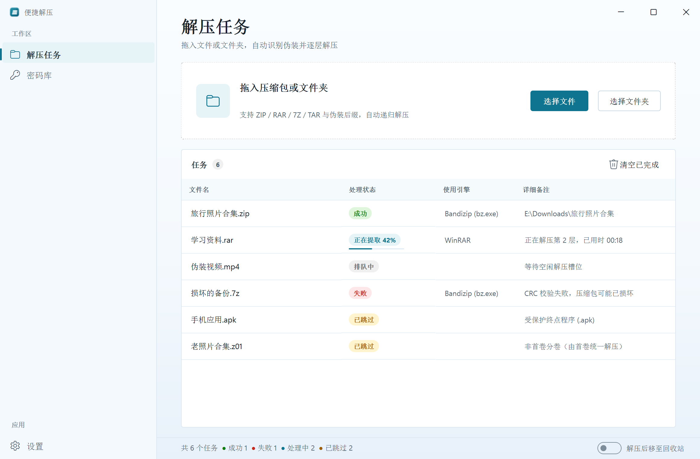
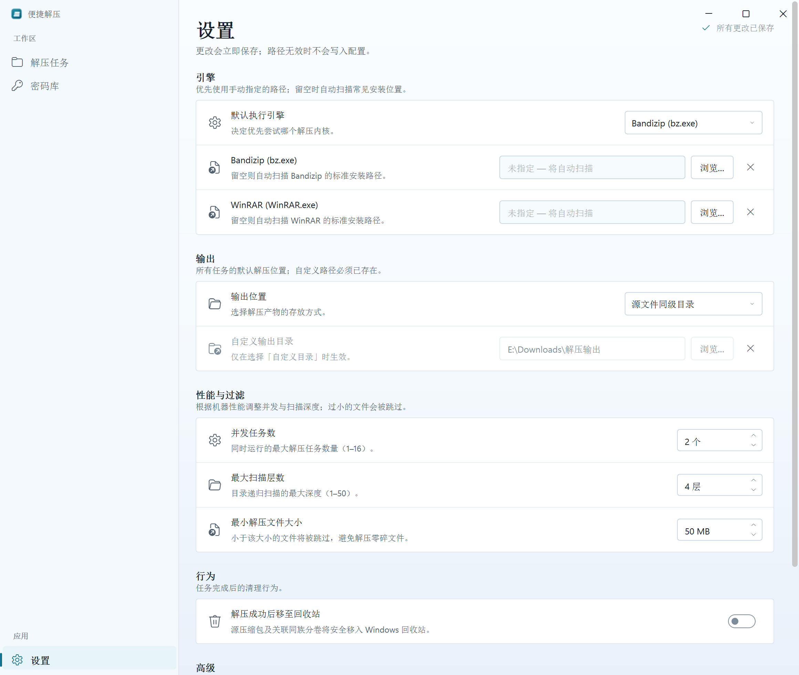
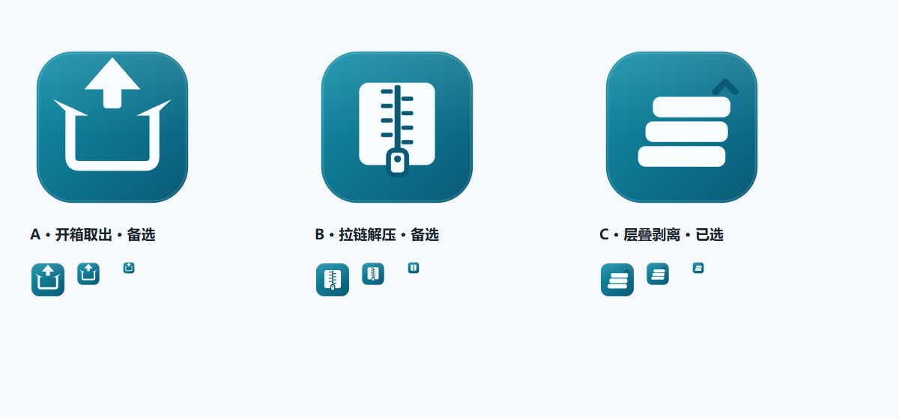

# 便捷解压 UI 重构方案 V2

> 状态：**方案稿，未动生产源码**。本文件只描述设计与实现计划，落地前需要你确认。
> V1 方案保留在 [`UI_REFACTOR_PLAN.md`](UI_REFACTOR_PLAN.md)，本文只写 V2 的增量与变化。
> 所有预览图由 `docs/mockups/fluent_prototype.py` 在 Windows 平台隐藏窗口抓取（`QT_SCALE_FACTOR=2`，不是 `QT_QPA_PLATFORM=offscreen`，否则缺字体）；使用假数据，不读写 `data/config.json` / `data/passwords.json`。

---

## 0. 一页结论

### 0.1 这次改了什么

| 你的反馈 | V2 的具体回应 |
|---|---|
| 蓝色偏绿一点 | 强调色从 Windows 蓝 `#005FB8` 改为青蓝 `#0E7490`；hover `#1483A0`、pressed `#0A5A70`、tint `#E6F4F8` |
| 背景浅蓝微微渐变 | 页面底层改为 `#FAFDFF → #F4F9FD → #E8F1FA` 的纵向渐变；卡片保持白色，导航 `#F3F9FD` |
| 设置页“还差点意思” | 从“一张设置一张卡片 + 底部保存/取消”改为 **PowerToys 0.92 式分组卡片 + 行内控件 + 自动保存 + 右上保存状态**；无底部按钮 |
| 更像微软那套 | 40px 自绘标题栏、260px NavigationView、Segoe Fluent Icons、28px 页标题、4px 圆角、1px 分层描边、键盘焦点与高 DPI |
| 中文名改“便捷解压” | 只改**显示名**：窗口标题、应用名、README、界面文案；技术标识 `ShellBreaker` / `shellbreaker` / EXE 名 / 数据目录全部不动 |
| 图标换一下，给想法 | 三个概念：A 开箱取出、B 拉链解压、C 层叠剥离；**已选 C**，并将图形整体下移 7% 做视觉居中；A/B 保留为备选 |
| 别动源码 | 本轮只改 `docs/`、`docs/mockups/`；`ui/`、`core/`、`data/`、`main.py` 均未改 |

### 0.2 推荐默认选项

| 决策 | 推荐 | 理由 |
|---|---|---|
| 图标 | **C 层叠剥离（已选）** | 三层错位 + 向上 chevron，强调“多层嵌套/递归剥离”；图形整体下移 7% 后视觉居中；16px 用简化版保留三层结构 |
| 设置保存 | **自动保存** | PowerToys 0.92 的实际交互；少一次“确定”点击；兼容层仍保留 `_on_save()` |
| 中文名 | **只改显示名** | 不影响现有打包、脚本、数据目录、测试和用户已有配置 |
| 强调色 | **`#0E7490`** | 比 `#0F6E8C` 更绿一点，白字对比度 5.36:1，达到 WCAG AA |
| 背景渐变 | **当前强度（很轻）** | 静态截图里可感知，但不抢卡片和表格；深色模式改为中性深灰渐变，不做蓝 |
| 导航断点 | **≥1008 展开，<1008 收起 48px 图标栏** | 参考 PowerToys 0.92 在 1001px 截图中的折叠阈值；V2 用 48px 图标栏而不是汉堡，减少一次点击；默认 1160 宽仍是展开态 |

### 0.3 预览

**任务页（浅色，青绿强调 + 浅蓝渐变 + 新名称/图标）**



**设置页（PowerToys 0.92 式分组卡片 + 自动保存）**



**图标：C 层叠剥离（已选，已下移 7% 做视觉居中）**



A/B 保留为备选；生产导出时，C 的 16px 版本采用“三层错位 + 去掉小 chevron”的简化处理，避免缩小后糊成一条。

更多图见第 10 节与 [`docs/mockups/README.md`](mockups/README.md)。

---

## 1. 目标、边界与成功标准

### 1.1 目标

1. 把现有“橙色卡片 + emoji 图标 + 大按钮”的工具型界面，重构为 **微软 Fluent / PowerToys 风格的桌面工具**。
2. 保留现有全部功能、按钮、状态语义和后台接口；只改信息架构、布局、控件、视觉和设置保存方式。
3. 中文显示名改为 **便捷解压**，并给出可落地的新图标。
4. 让设置页从“表单对话框”变成“系统设置页”：分组、行内控件、自动保存、即时校验、恢复默认。

### 1.2 包含

- 导航壳：标题栏、左侧 NavigationView、页面容器、响应式折叠。
- 三个页面：解压任务、密码库、设置。
- 设置页的重新设计：五组分组卡片、自动保存、状态提示、恢复默认、清空缓存。
- 任务页/密码库页的 V2 视觉刷新（渐变、青绿强调、行高、状态胶囊）。
- 对话框：密码输入、导入预览、确认类 ContentDialog。
- 新显示名与新图标（含多尺寸导出与打包路径）。
- 浅色 + 深色 token；高 DPI、键盘焦点、可访问性。
- 现有测试兼容层；新增 UI 冒烟测试。

### 1.3 不包含

- 不改 `core/` 的解压、扫描、密码学习、沙箱逻辑。
- 不改 `TaskQueue` / `ConfigManager` / `PasswordManager` 的公开方法签名。
- 不新增业务功能（不做任务搜索、不做密码搜索、不做关于页、不做自动更新）。
- 不改技术包名、EXE 名、`data/` 路径、配置键名。
- 不暴露 `disguise_min_size_mb`（它仍是内部配置，避免新增未定义的界面行为）。

### 1.4 成功标准

- V1 控制映射中的每个按钮/菜单项都能在新界面找到；不出现“重构后少了一个按钮”。
- 现有 `tests/test_feature_updates.py:585-746` 的 UI 测试不需要改断言即可通过。
- 设置页所有控件在构造后立即可访问；`SettingsDialog._on_save()` 仍能强制落盘。
- 浅色强调色白字对比度 ≥ 4.5:1；正文/次要文字对比度 ≥ 4.5:1 / 3:1。
- 16/32/48/256 图标均可辨识；`app_icon.ico` 含多尺寸。
- 125% / 150% / 200% DPI 下无文字截断、无控件重叠。
- 键盘可完成：切页、选择文件/目录、打开右键菜单、设置项编辑、对话框确认/取消。

---

## 2. 从 PowerToys 学到的具体东西

### 2.1 两代 PowerToys 设置页的差异

| 观察 | PowerToys 0.45 截图 | PowerToys 0.92.1 截图 | V2 取舍 |
|---|---|---|---|
| 导航 | 左侧 260px 全展开 | 1001px 宽时收起为汉堡 | 默认 1160 展开；<1008 收起 48px 图标栏 |
| 页面边距 | 约 40px | 约 16px | 24px（比 0.92 舒展，比 0.45 紧凑） |
| 设置项 | 一张卡一个设置 | **一个分组卡内多行**，行间 1px 分隔 | 采用分组卡 |
| 卡片 | 白底、1px 边框、4px 圆角 | 白底、1px 边框、4px 圆角 | 同 0.92 |
| 保存 | 部分页面有保存/取消 | **即时生效，无底部保存栏** | 自动保存 + 右上状态 |
| 标题 | 28px 页标题 | 28px 页标题，顶部更紧凑 | 28px，24px 边距 |
| 强调色 | 蓝 | 蓝 | 改为青蓝，保留同一套语义 |

### 2.2 借用的数值

| 项 | 数值 | 来源/说明 |
|---|---|---|
| 标题栏 | 40px | Magpie `TitleBarControl` / PowerToys |
| 导航宽 | 260px 展开；48px 收起 | PowerToys 0.45 导航 + 0.92 折叠 |
| 页面标题 | 28px / 600 | Magpie `PageFrame` / PowerToys |
| 页面边距 | 24px | PowerToys 0.92 的 16 与 0.45 的 40 之间 |
| 内容最大宽 | 960px | 宽屏不拉成超长输入框 |
| 分组卡 | 白底 / 1px `#DCE7F1` / 4px 圆角 | PowerToys SettingsCard |
| 设置行 | 64px 高 / 16px 内边距 / 1px 分隔 | PowerToys SettingsCard 68px 的紧凑版 |
| 控件高度 | 32px | Fluent 标准 |
| 控件圆角 | 4px | Fluent |
| 字体 | Segoe UI Variable Text + Microsoft YaHei UI 回退 | Windows 11 中文 |
| 图标 | Segoe Fluent Icons 16px | 已核对字形，Win10 回退 MDL2 |

### 2.3 不照搬的部分

- 不做 PowerToys 的模块列表/每模块设置页；本项目只有三个页面。
- 不做 PowerToys 的“管理员模式/更新/开机启动”等不存在的能力。
- 不把设置页做成“每项一个 Expander”；分组卡更像 0.92，也更适合本项目 10 个设置项。
- 不引入 WinUI 依赖；仍用 PySide6 + QSS + 少量自绘控件。

---

## 3. V2 设计系统

### 3.1 强调色

| 候选 | 色值 | 白字对比度 | 评价 |
|---|---|---:|---|
| Windows 蓝（V1） | `#005FB8` | 6.31 | 太“系统默认”，用户觉得不够绿 |
| 青蓝（推荐） | **`#0E7490`** | **5.36** | 比蓝绿、比青稳；按钮/选中/进度统一 |
| 更深的青 | `#0F6E8C` | 5.79 | 更沉，但绿色感略弱 |
| 系统青 | `#1D6978` | 6.28 | 偏灰，作为“跟随系统”备选 |
| 品牌橙（V1 备选） | `#C2410C` | 5.17 | 保留品牌识别时使用，不作为 V2 默认 |

推荐 token：

```
accent          #0E7490
accent_hover    #1483A0
accent_pressed  #0A5A70
accent_text     #FFFFFF
accent_tint     #E6F4F8
selection       #EAF5F9
```

深色：

```
accent          #5BC8D8
accent_text     #071A1F
accent_tint     #17343B
selection       #1B3A42
```

### 3.2 背景渐变

浅色页面底层：

```
0.0   #FAFDFF
0.55  #F4F9FD
1.0   #E8F1FA
```

- 纵向 `QLinearGradient`，由 `Shell.paintEvent` 绘制；`QWidget#Root/#Content/#Page/QStackedWidget` 透明，避免 QSS 实色盖住渐变。
- 导航 `#F3F9FD`，比页面顶部略深，形成“导航—内容”分层。
- 卡片 `#FFFFFF` 不透明，保证表格/输入框对比度。
- 状态栏透明，直接落在渐变上。
- 深色不做蓝渐变：`#242C32 → #1E2429 → #191F24`，避免“蓝色暗黑”廉价感。

### 3.3 Token 表

| Token | 浅色 | 深色 | 用途 |
|---|---|---|---|
| `window_top` | `#FAFDFF` | `#242C32` | 渐变起点 |
| `window_mid` | `#F4F9FD` | `#1E2429` | 渐变中点 |
| `window_bottom` | `#E8F1FA` | `#191F24` | 渐变终点 |
| `nav` | `#F3F9FD` | `#1B2228` | 导航底 |
| `card` | `#FFFFFF` | `#262E34` | 卡片/表格 |
| `card_border` | `#DCE7F1` | `#3A464F` | 卡片/表格边框 |
| `text` | `#16212B` | `#F4F8FA` | 主文字 |
| `text2` | `#52616F` | `#C3CDD4` | 次要文字 |
| `text3` | `#7E8D9A` | `#8C9AA4` | 说明/禁用 |
| `control` | `#FFFFFF` | `#2B343B` | 输入/按钮底 |
| `control_border` | `#C9D8E5` | `#46545E` | 控件边框 |
| `control_hover` | `#F5FAFD` | `#323D45` | hover |
| `divider` | `#E7EFF6` | `#344048` | 分隔线 |
| `row_hover` | `#F7FBFE` | `#2B353C` | 表格行 hover |
| `selection` | `#EAF5F9` | `#1B3A42` | 选中行/导航选中 |
| `success` | `#0F7B0F` | `#6CCB5F` | 成功 |
| `danger` | `#C42B1C` | `#FF99A4` | 失败/危险 |
| `warning` | `#9D5D00` | `#FCE100` | 跳过/警告 |
| `neutral` | `#5D5D5D` | `#C5C5C5` | 排队 |
| `shadow` | `rgba(23, 58, 82, 0.14)` | `rgba(0, 0, 0, 0.45)` | 对话框阴影 |

### 3.4 字体与字号

| 用途 | 字体/字号/字重 |
|---|---|
| 应用字体 | `Segoe UI Variable Text`, `Microsoft YaHei UI`, `Segoe UI`, sans-serif |
| 页标题 | 28px / 600 |
| 页副标题 | 13px / 400 / `text2` |
| 分组标题 | 14px / 600 |
| 分组说明 | 12px / `text2` |
| 行标题 | 13px / 400 |
| 行说明 | 12px / `text2` |
| 表格表头 | 11px / 600 / `text2` |
| 表格正文 | 13px；引擎/备注 12px |
| 密码/路径 | `Cascadia Mono`, `Consolas`, monospace（密码 13px；路径 12px） |
| 状态胶囊 | 11px / 600 |
| 标题栏名称 | 12px / `text2` |

### 3.5 间距、圆角、尺寸

- 间距阶梯：4 / 8 / 12 / 16 / 20 / 24 / 32。
- 圆角：控件 4；卡片 4；对话框 8；图标底板 8；状态胶囊 10（全圆）。
- 页面边距：24；分区间距 24；分组标题与卡片 8。
- 设置行：64 高；左右 16；图标—文字 12；文字—控件 24。
- 控件：32 高；主按钮最小 88 宽；对话框按钮最小 88。
- 表格：行 44；表头 36；首列 16 左内边距。
- 标题栏：40；导航 260/48；状态栏 36。

### 3.6 控件规范

| 控件 | 规范 |
|---|---|
| Primary | 青蓝底、白字、600；hover 亮一档、pressed 暗一档；disabled 40% |
| Secondary | 白底、`control_border`、主文字；hover 浅青灰 |
| Subtle | 透明底、无边框；hover 浅底；危险项红字 |
| IconButton | 32×32；16px glyph；hover 浅底；tooltip 必填 |
| TextBox | 32 高；1px 边框；focus 2px accent；placeholder `text3`；错误态红边 |
| ComboBox | 32 高；200 宽；右侧 chevron；菜单圆角 4 |
| NumberBox | 124×32；左值右步进；步进 16×16；范围 1–16 / 1–50 / 1–10000 |
| ToggleSwitch | 40×20；开 accent；关 `control_border`；必须继承 `QCheckBox`，保留 `setChecked`/`toggled` |
| 状态胶囊 | 20 高；11/600；success/danger/warning/neutral 四套底色 |
| 表格 | 无斑马纹；行分隔 1px；选中 `selection`；表头不排序 |
| 对话框 | 440/500 宽；24 内边距；标题 20/600；按钮右对齐 |
| 焦点环 | 2px `accent`，offset 1；键盘可见，鼠标点击不抢眼 |

---

## 4. 壳、标题栏与导航

### 4.1 标题栏

- 40px 高；左侧 16px 图标 + 8px 间距 + “便捷解压” 12px `text2`。
- 右侧三个 46×32 按钮：最小化 `E921`、最大化/还原 `E922/E923`、关闭 `E8BB`；关闭 hover `#C42B1C` 白字。
- 拖动、双击最大化、贴边 snap 在 P3 用 `QWindow.startSystemMove()` / `startSystemResize()` / `nativeEvent` 实现；P1 先用原生标题栏。
- 标题栏不显示副标题、版本号；版本号只在 README/关于未来再说。

### 4.2 导航

- 展开 260px：应用图标 + 名称，分组标题“工作区”，任务/密码库，底部“应用”+ 设置。
- 选中：3px accent 左条 + `selection` 底 + 主文字；hover：`control_hover`。
- 导航项 40px 高；16px glyph；14px 文字；左右 12px 内边距。
- 底部固定“设置”，不随内容滚动。
- <1008 收起为 48px 图标栏：只显示图标 + tooltip；当前页图标 accent；设置仍在底部。
- <640：顶部 48px 栏 + 汉堡弹出导航；这是兜底，不作为主设计。

### 4.3 页面容器

- 默认窗口 1160×760，最小 900×600（当前为 840×600；V2 放大以容纳 260px 导航和 4 列表格）。
- 内容最大宽 960，水平居中；左右 24；顶部 24；底部 24。
- 页面滚动区透明；滚动条 10px 圆角；内容不被标题栏遮挡。
- 页面切换用 `QStackedWidget`；不引入页面转场动画，避免桌面工具“花哨”。

---

## 5. 页面设计

### 5.1 解压任务页

结构：

1. 页标题“解压任务” + 副标题“拖入文件或文件夹，自动识别伪装并逐层解压”。
2. 拖放卡：128 高；左侧 56px 圆角图标底板（青绿 tint）；标题“拖入压缩包或文件夹” 16/600；副标题“支持 ZIP / RAR / 7Z / TAR 与伪装后缀，自动递归解压” 12；右侧“选择文件”（Primary）+“选择文件夹”（Secondary）。
3. 任务卡：标题“任务” + 数量胶囊 + 右侧“清空已完成”（Subtle，垃圾桶 16）；表头 4 列；表格；空状态。
4. 底部状态栏 36px：总任务 / 成功 / 失败 / 处理中 / 已跳过；右侧“解压后移至回收站” ToggleSwitch。

V2 变化：

- 背景渐变 + 青绿强调；状态栏透明。
- 表头左对齐；任务数胶囊；空状态。
- “清空已完成”保留，禁用态在 0 任务时；不新增“清空缓存”到本页，清缓存仍在设置页高级。
- 右键菜单 4 项不变；双击定位不变。

### 5.2 密码库页

结构：

1. 页标题“密码库” + 副标题“共 N 条密码 · 按使用频率排序”；右上“添加密码” Primary。
2. 表卡：标题“全部密码” + 数量；工具栏“从剪贴板导入 / 从文件导入 / 删除 / 清空”；3 列表格。
3. 空状态：“还没有保存的密码” + “从剪贴板或文件导入，或在解压时自动学习”。

V2 变化：

- 只做视觉刷新：表头左对齐、青绿按钮、渐变背景、行高 44、等宽密码字体。
- 三列表头严格保持 `密码（明文）` / `使用次数` / `标签`；测试硬耦合。
- “清空”红字；删除/清空确认对话框改为 Fluent ContentDialog。
- 导入预览仍显示前 5 条 + “还有 N 条…”；计数与重复提示不变。

### 5.3 设置页（重点重做）

#### 5.3.1 页面骨架

- 24px 页边距；内容最大宽 960。
- 页标题“设置” 28/600；副标题“更改会立即保存；路径无效时不会写入配置。” 13。
- 右上状态：`✓ 所有更改已保存`（12，`text3`）；保存中/无效时切换文案与颜色。
- 五个分组，每组 = 分组标题（14/600）+ 说明（12）+ 白色分组卡（1px 边框，行间 1px 分隔）。
- **无底部保存/取消栏**；所有有效更改自动落盘。
- 页面底部留 24px；高级组可滚动到。

#### 5.3.2 分组与行

| 分组 | 行 | 控件 | 自动保存规则 |
|---|---|---|---|
| 引擎 | 默认执行引擎 | ComboBox：Bandizip (bz.exe) / WinRAR (WinRAR.exe) | 选择后写 `default_engine`；失败不写 |
| 引擎 | Bandizip (bz.exe) | PathControl：只读路径 + 浏览 + 清除 | 非空且 `os.path.isfile` 才写 `bandizip_path`；清空写 `""` |
| 引擎 | WinRAR (WinRAR.exe) | 同上 | 同上，写 `winrar_path` |
| 输出 | 输出位置 | ComboBox：源文件同级目录 / 自定义目录 | 写 `output_mode`；选自定义但路径无效时，保持旧值并提示 |
| 输出 | 自定义输出目录 | PathControl；源目录模式下整行 muted/disabled | 目录存在才写 `custom_output_path` |
| 性能与过滤 | 并发任务数 | NumberBox 1–16 | 值变化写 `max_workers`；防抖 400ms 后 `_task_queue.reload_config()` |
| 性能与过滤 | 最大扫描层数 | NumberBox 1–50 | 写 `max_scan_depth` |
| 性能与过滤 | 最小解压文件大小 | NumberBox 1–10000 MB | 写 `min_file_size_mb` |
| 行为 | 解压成功后移至回收站 | ToggleSwitch | 立即写 `delete_source_after_extract`；同步任务页开关 |
| 高级 | 临时文件 | “清空缓存…”危险 Subtle 按钮 | 不写配置；确认后 `SandboxManager.clean_all()` |
| 高级 | 恢复默认设置 | “恢复默认” Subtle 按钮 | 确认后 `ConfigManager.reset_defaults()`；刷新页面；同步任务页开关 |

说明：

- `disguise_min_size_mb` 仍不暴露；避免新增用户不理解的“伪装包最小识别大小”。
- 引擎路径保持**只读 + 浏览**，不改成可手输；这与现有 SettingsDialog 行为一致，避免“看起来能输入但不会保存”的假接口。
- 输出自定义路径同样只读 + 浏览；当前实现也是浏览按钮，不新增文本编辑能力。
- 数字框允许键盘输入；失焦/回车时 clamp 并保存。

#### 5.3.3 自动保存与校验

状态机：

| 状态 | 触发 | 显示 | 写盘 |
|---|---|---|---|
| `saved` | 页面打开 / 保存成功 | `✓ 所有更改已保存` `text3` | 否 |
| `saving` | 值变化，校验通过 | `正在保存…` `text3` | 400ms 防抖后写 |
| `invalid` | 路径为空/不存在/不是文件 | `路径无效，尚未保存` `danger` + 行内红字 | **不写** |
| `reset` | 恢复默认确认后 | `已恢复默认设置` 2s 后回 `saved` | `reset_defaults()` 内部保存 |

规则：

1. 每次只写一个键：先 `ConfigManager.set(key, value)`，再 `save()`；失败时恢复内存值并显示错误。
2. 路径类先校验再写；浏览对话框返回的路径本身已存在，正常不会失败。
3. 自定义输出目录在“源文件同级目录”模式下 disabled；切到自定义才启用。
4. `max_workers` 的写盘防抖 400ms；`reload_config()` 会重建线程池，避免每按一次步进重启一次。
5. 设置页发出 `settingsChanged` 信号；MainWindow 收到后：
   - 同步任务页 `_cb_delete_source`（阻止信号递归）；
   - 在引擎/并发变化时调用 `_task_queue.reload_config()`；
   - 不重启任务、不清空看板。
6. `SettingsDialog._on_save()` 作为兼容层调用 `page.flush()`：强制把当前控件值校验并写盘；返回 `bool`。测试用它，生产页面不显示该按钮。

#### 5.3.4 恢复默认与清空缓存

- 恢复默认：ContentDialog 标题“恢复默认设置？”，正文“将重置引擎、输出、性能与行为设置；不会删除密码库和已完成任务。”；确认后 `reset_defaults()`，刷新所有控件，状态显示 2 秒。
- 清空缓存：沿用现有文案“确定要清除所有沙箱临时文件吗？”，确认后 `clean_all()`，InfoBar 显示清理数量。
- 两个危险操作都放在“高级”组，不与常用设置混在一起。

### 5.4 对话框

| 对话框 | 触发 | 结构 |
|---|---|---|
| 需要密码 | `password_needed(task_id, archive_name)` | 440 宽；标题“需要密码”；正文“`<archive>` 已加密。密码库中没有可用密码，请输入密码继续。”；密码框 + 显示/隐藏；错误行红字；取消 / 继续解压 |
| 重新输入密码 | `password_wrong(task_id)` | 复用同一对话框，错误行“密码错误，请重试”；取消 = `supply_password(None)` |
| 导入预览 | 剪贴板/文件导入 | 500 宽；标题“导入密码”；正文“识别到 N 条，其中 M 条已存在”；前 5 条预览 + 还有 N 条；取消 / 导入 N 条 |
| 删除选中 | 密码库 | 440 宽；标题“删除选中的密码？”；正文列出数量；取消 / 删除 |
| 清空密码库 | 密码库 | 440 宽；标题“清空密码库？”；正文“此操作不可撤销”；取消 / 清空 |
| 恢复默认 | 设置·高级 | 见 5.3.4 |
| 清空缓存 | 设置·高级 | 见 5.3.4 |
| 列表移除 | 任务右键“从列表中移除” | 不弹确认（与现行为一致） |

对话框统一：

- 背景 dim `rgba(0,0,0,0.30)`；卡片白/深色 `card`；8px 圆角；阴影。
- 标题 20/600；正文 13；按钮右对齐，最小 88 宽；危险操作红字。
- Esc = 取消；Enter = 主操作；Tab 焦点循环；打开时聚焦输入框/主按钮。
- 密码框默认遮罩，右侧眼睛按钮切换明文；关闭/取消必须 `supply_password(None)`，不能留下等待线程。

### 5.5 空状态与反馈

- 任务空状态：文件夹 glyph 48 + “还没有解压任务” 16/600 + “将文件或文件夹拖到上方，或点击「选择文件」开始” 12。
- 密码空状态：钥匙 glyph 48 + “还没有保存的密码” + 说明。
- 非阻塞结果用 InfoBar（页面顶部或底部），不用 QMessageBox；错误仍可用 ContentDialog。
- 拖放悬停：拖放卡边框变 2px accent、底色 accent tint；离开恢复。
- 状态胶囊：成功/失败/正在提取/验证密码/排队中/已跳过；保留原始状态文本，不归一化。

---

## 6. 应用身份：名称与图标

### 6.1 名称

**显示名：便捷解压**。技术名不变。

| 位置 | 现在 | V2 |
|---|---|---|
| 窗口标题 `ui/main_window.py:180` | `懒人解压😋` | `便捷解压` |
| 应用名 `main.py:96` | `懒人解压😋` | `便捷解压` |
| 启动日志 `main.py:87` | `懒人解压😋 (ShellBreaker) 启动` | `便捷解压 (ShellBreaker) 启动` |
| `ui/main_window.py:176` docstring | `懒人解压😋 主窗口。` | `便捷解压 主窗口。` |
| README 标题 | `懒人解压😋` | `便捷解压` |
| 关于/版本 | 无 About 页 | 不加 |
| 技术包/脚本/EXE/数据目录 | `ShellBreaker` / `shellbreaker` / `data/` | **不变** |

理由：用户已有的 `data/config.json`、`data/passwords.json`、日志路径、PyInstaller 配置、测试和快捷方式都依赖技术名。只改显示名可以“看起来全新”，但不制造迁移问题。

### 6.2 图标概念（已选 C）


| 概念 | 图形 | 优点 | 风险 |
|---|---|---|---|
| A 开箱取出（备选） | 白色开口箱体 + 向上箭头 | 16px 仍可读；“取出/解压”语义直接；无文字，跨语言 | 可能被读成“上传/下载”；需要靠箱体轮廓区分 |
| B 拉链解压（备选） | 白色档案箱 + 拉链齿 + 拉头 | “解压”最直白；有工具感 | 16px 齿太密，容易像温度计/电池；需要单独简化 16px 版 |
| **C 层叠剥离（已选）** | 三层白色圆角层 + 向上 chevron | 强调“多层嵌套/递归剥离”，是项目最有辨识度的能力 | 缩小后可能像列表/菜单；需要靠错位、层宽和间隙区分 |

**选择 C 的原因**

- C 把“多层压缩包/递归剥离”这个项目最有辨识度的能力放进图标；A/B 更像通用解压工具，无法表达“层层剥离”。
- 视觉重心修正：原稿从 chevron 到最下层的中点在图标上方，显得头重脚轻；C 的图形整体**下移 7%** 后，白色块重心回到约 49%，与圆角方形视觉中心一致。
- 16px 仍保留三层错位；生产导出时 16/20/24 单独简化（去掉 chevron、加大层间距），避免糊成一条。
- 风险控制：缩小后若像列表，用三层不同宽度 + 更明显的青色间隙区分；大尺寸场景保留完整 chevron。

**A/B 的定位**

- A 作为“解压/取出”的通用备选，适合未来如果 C 在小尺寸测试中辨识度不达标时回退。
- B 可作为“压缩包/解压引擎”的功能图标（例如设置页引擎行），不适合做应用主图标。

### 6.3 图标落地规格

- 主图 512×512 PNG，导出 256/128/64/48/32/24/16。
- `assets/app_icon.png` 256×256；`assets/app_icon.ico` 多尺寸（16/24/32/48/64/128/256）。
- 16/20/24 单独简化：C 去掉小 chevron、加大三层间距；A 加粗箭头/箱体；B 减少齿数。不要只把 512 缩到 16。
- 安全区：四周留 10%；圆角 22%；不透明底，避免任务栏/标题栏透底。
- 当前 V2 预览使用 C；单个尺寸见 `mockups/out/icons/c_layers_*.png`。
- 生产替换仍用原路径 `assets/app_icon.png` / `.ico`，`ShellBreaker.spec` 的 `datas` 不需要新增文件；若改用 SVG，再更新 spec。

---

## 7. V1 → V2 功能映射（重点：不丢按钮）

### 7.1 保留不变

- 任务页：选择文件、选择目录、清空已完成、右键 4 项、双击定位、拖放、状态栏、回收站开关。
- 密码库：添加、剪贴板导入、文件导入、删除、清空、3 列表格。
- 设置：引擎路径浏览/清除、默认引擎、输出模式/路径、并发、扫描层数、最小大小、回收站开关。
- 清空缓存（从主窗口底部移到设置·高级；V1 已决定，V2 保留）。
- 恢复默认（`ConfigManager.reset_defaults` 已存在；V1 未暴露，V2 放在高级组）。

### 7.2 变化

| 项 | V1 | V2 |
|---|---|---|
| 导航选中色 | 蓝 | 青蓝 |
| 页面背景 | 纯色 `#F3F3F3` | 浅蓝纵向渐变 |
| 设置项呈现 | 一张卡一个设置 | 分组卡 + 行分隔 |
| 设置保存 | 底部保存/取消 | 自动保存 + 右上状态 |
| 设置页脚 | 固定 56px | 无 |
| 标题栏名称 | 懒人解压 | 便捷解压 |
| 图标 | 橙色“解压” | C 层叠剥离（下移 7%） |
| 清空缓存 | 设置·高级 | 设置·高级（不变） |
| 恢复默认 | 未暴露 | 设置·高级（新增，API 已存在） |
| 密码/设置对话框 | 页面 + 兼容 wrapper | 页面 + 兼容 wrapper（不变） |

### 7.3 不新增的“假接口”

- 不做任务搜索框（没有搜索后端）。
- 不做密码搜索框（数据量小，且没有搜索 API）。
- 不做“检查更新”（没有更新服务）。
- 不做“开机启动”（没有注册表/启动项逻辑）。
- 不做“关于”页（没有版本服务/仓库链接配置）。
- 不暴露 `disguise_min_size_mb`（内部参数，不引导用户改）。
- 不把引擎路径做成可手输（现有行为是只读 + 浏览；避免假可编辑）。

---

## 8. 技术实现方案

### 8.1 目录结构（计划）

```
ui/
  theme/
    tokens.py          # LIGHT/DARK/V2_LIGHT/V2_DARK + 语义 token
    theme_manager.py   # ensure_theme(app), 监听系统主题（P3）
    qss.py             # token -> QSS；@token 替换
    icons.py           # Segoe Fluent/MDL2 字形 + 16/20/24 映射
  widgets/
    title_bar.py       # 40px 自绘标题栏（P3）
    navigation.py      # 260/48 导航
    setting_row.py     # 64px 行
    settings_group.py  # 分组卡
    number_box.py      # 124x32
    toggle_switch.py   # 继承 QCheckBox
    content_dialog.py  # 统一对话框
    status_pill.py
    drop_card.py
  pages/
    tasks_page.py
    passwords_page.py
    settings_page.py   # V2 重点
  main_window.py       # 壳 + 兼容属性
  settings_dialog.py   # 兼容 wrapper -> SettingsPage
  password_dialog.py   # 兼容 wrapper -> PasswordPage
```

### 8.2 渐变实现

- `Shell` 继承 `QWidget`，`paintEvent` 用 `QLinearGradient(0, 0, 0, height)`，三段 stop：0 / 0.55 / 1。
- QSS 中 Root/Content/Page/StackedWidget/ScrollArea viewport 全部 `background: transparent`。
- 页面滚动时，渐变固定在窗口底层，不随内容滚动；这比给每个页面设背景更稳。
- 缓存一张 `QPixmap` 按窗口尺寸重绘，避免每次 paint 重新构造 gradient；resize 时丢弃缓存。
- 深色单独 token；不把浅色渐变硬编码进 QSS。

### 8.3 设置页自动保存

- `SettingsPage` 持有 `ConfigManager`，构造时只读，不写盘。
- 每个控件连接 `valueChanged` / `currentIndexChanged` / `toggled` → `_on_value_changed(key, value)`。
- `_on_value_changed`：
  1. 校验（路径/数字范围）。
  2. 失败：设置行错误态、状态 `invalid`、return。
  3. 成功：`config.set(key, value)`；`config.save()`；状态 `saving` → `saved`；发 `settingsChanged(key)`。
- 文本/数字防抖 400ms；ComboBox/Toggle 立即保存。
- `flush()`：遍历控件，按同样规则强制写一遍，返回 `bool`；供 `SettingsDialog._on_save()`。
- `reload_from_config()`：恢复默认/外部变更后重建控件值，`blockSignals` 避免递归。
- `settingsChanged` 只在真正写盘成功后发出；MainWindow 用于同步 `_cb_delete_source` 与 `reload_config`。

### 8.4 兼容层

- `SettingsDialog(QDialog)`：
  - 内部 `SettingsPage`；`_cb_delete_source` 属性代理到 page 的 ToggleSwitch；
  - `_on_save()` 调 `page.flush()`；
  - 构造后控件立即可用；
  - 不再显示保存/取消按钮（测试只调 `_on_save`）。
- `PasswordDialog(QDialog)`：同 V1，内部 `PasswordPage`；`_table` 3 列/表头/5 个按钮/`_refresh_table` 代理。
- `MainWindow`：保留 `_table/_task_rows/_task_data/_cb_delete_source/_on_task_status_changed/dropEvent/_on_drop_paths_ready`；页面是 `TasksPage`，壳负责拖放，避免 DropZone 和 Shell 双提交。
- 主题：`ensure_theme(app)` 在 `main.py`、`MainWindow.__init__`、两个 wrapper 里幂等调用；测试不跑 `main.py` 也能有样式。

### 8.5 名称与图标

- 只改显示字符串；不改 `ShellBreaker.spec` 的 `name='ShellBreaker'`、`pyproject.toml` 的包名/脚本名、`data/` 路径。
- 图标替换原路径；`main.py` 继续加载 `assets/app_icon.png`；frozen 分支的 `_MEIPASS` 探测不变。
- 若新增 `.ico` 多尺寸：用 Pillow/Qt 生成；不改 spec 的 datas 列表。
- README 标题改名；版本号 1.0.6 不动。

---

## 9. 阶段与工作量

| 阶段 | 内容 | 预估 |
|---|---|---|
| P0 身份与 token | 显示名、图标 C（下移 7% + 多尺寸简化）、V2 token、渐变、`ensure_theme`、QSS 骨架 | 0.5–1 天 |
| P1 壳 + 任务页 | 标题栏/导航/页面容器、任务页 V2、拖放、状态栏 | 1–1.5 天 |
| P2 设置页 V2 | 分组卡、行控件、自动保存、校验、恢复默认、清空缓存、兼容层 | 1.5–2 天 |
| P3 密码库 + 对话框 | 密码页 V2、密码/导入/确认对话框、空状态 | 1 天 |
| P4 响应式/深色/验收 | 1008 折叠、深色、DPI、键盘、测试、打包 | 1–1.5 天 |
| **合计** | | **5–7 天** |

> 比 V1 多约 1 天，主要是设置页自动保存/校验/兼容层，以及新图标多尺寸。

### 文件改动清单（落地时）

- 新增：`ui/theme/*`、`ui/widgets/*`、`ui/pages/*`。
- 改写：`ui/main_window.py`、`ui/settings_dialog.py`、`ui/password_dialog.py`。
- 小改：`main.py`（显示名/主题/图标）、`README.md`（标题/截图）、`assets/app_icon.png`、`assets/app_icon.ico`。
- 不改：`core/*`、`data/*`、`tests/*`（除非测试断言旧标题；目前未发现）。
- 不改：`ShellBreaker.spec`（图标路径不变）；若改 SVG 再更新 datas。

---

## 10. 验收与测试

### 10.1 现有测试

- `tests/test_feature_updates.py:585-746` 必须通过，不改断言：
  - `SettingsDialog._cb_delete_source.setChecked(True)` + `_on_save()` 后重开仍勾选；
  - `MainWindow._cb_delete_source` 勾选实时写 config；
  - `MainWindow._table` / `_task_rows` / `_task_data` / `_on_task_status_changed` / `dropEvent` / `_on_drop_paths_ready`；
  - 表格第 0/1/3 列文本；
  - `PasswordDialog._table.columnCount()==3`、表头精确、5 个按钮非空、`_refresh_table()`。
- 兼容层必须“构造即可用”，不能懒加载页面。

### 10.2 新增 UI 冒烟测试（建议）

- 打开 MainWindow，切三页，检查 `QStackedWidget.count()==3`。
- 设置页改并发数，`ConfigManager.get("max_workers")` 立即变化；无效路径不写。
- 恢复默认后，`delete_source_after_extract` 回到 `False`，任务页开关同步。
- 1008/1007 宽度切换，导航 260 ↔ 48。
- 图标 16/32/48/256 存在且非空。
- 密码对话框取消 → `supply_password(None)` 被调用（用 fake queue）。

### 10.3 手工验收

- 125% / 150% / 200% DPI：标题、表格、设置行不截断；路径文本省略号 + tooltip。
- 键盘：Tab 顺序、Enter 主操作、Esc 取消、Focus 可见。
- 浅色/深色：所有状态胶囊、错误行、禁用行对比度。
- 真实拖放：文件/目录/伪装后缀/非首卷/过小/受保护终点；状态与统计正确。
- 右键 4 项、双击定位、清空已完成、清空缓存、恢复默认。
- 旧配置迁移：`data/config.json` 缺键/多键、自定义路径不存在、引擎路径失效。
- 密码库：空状态、导入重复、删除、清空、密码错误重试。

### 10.4 遗漏自检

- 对照 V1 第 7 节 M01–M23 / S01–S13 / P01–P10 逐项打勾。
- 设置页：保存/取消按钮删除，但 `_on_save()` 兼容；所有配置键仍有控件或明确“不暴露”。
- 任务页：清空缓存移走但未丢；回收站开关两处同步。
- 密码页：3 列文本不变；导入预览/确认不丢。
- 标题栏：最小化/最大化/关闭/拖动/双击。
- 无新增假接口（搜索/更新/开机启动/关于/伪装大小）。

---

## 11. 风险与回滚

| 风险 | 影响 | 缓解 |
|---|---|---|
| 自动保存误写 | 用户改坏配置 | 先校验后写；失败不写；恢复默认；日志记录键值 |
| `_task_queue.reload_config()` 频繁重启 | 正在解压的任务被取消 | 仅并发/引擎变化时防抖调用；输出/过滤设置不重启 |
| 渐变被 QSS 实色盖住 | 背景变纯色 | Root/Content/Page/ScrollArea 全透明；在真实窗口验证 |
| 自绘标题栏 snap/最大化异常 | 窗口行为退化 | P1 先用原生标题栏；P3 再做自绘并保留回退开关 |
| 图标 16px 糊 | 任务栏/标题栏辨识差 | A 方案 + 单独 16px 简化；导出前逐尺寸看 |
| 改名影响测试/打包 | 构建失败 | 只改显示字符串；技术名不动；全量跑测试 |
| QSS `:disabled` 不生效 | 禁用行看起来可点 | 行级 `setEnabled(False)` + 颜色/背景双保险 + 截图验收 |
| 设置页过长 | 小屏看不到高级 | 滚动；<700 高度时内容可滚；不固定页脚 |

回滚：

- 设计层：V2 文档/截图独立，删除 `docs/UI_REFACTOR_PLAN_V2.md` 和 `v2_*` 即回到 V1。
- 实现层：按阶段提交；主题/页面/兼容层分开，任一步可回退到 V1 分支。

---

## 12. 决策状态

### 已确认

1. **图标 C 层叠剥离**，图形整体下移 7%，视觉居中；V2 预览与概念图已按此更新。
2. **设置页自动保存**（PowerToys 0.92 式，无底部保存/取消；兼容层保留 `_on_save()`）。
3. **只改显示名“便捷解压”**；技术名 `ShellBreaker`、EXE、`data/` 路径不动。

### 还需你点头的视觉微调（不阻塞）

1. **强调色**：`#0E7490`（推荐）/ `#0F6E8C`（更深）/ 跟随系统青 `#1D6978`？
2. **渐变强度**：当前很轻（推荐）/ 底部再蓝一点？
3. **导航断点**：1008px 折叠（推荐，参考 PowerToys 0.92）/ 920px（Magpie）/ 始终展开？
4. **设置页密度**：24px 边距 + 64px 行（推荐）/ 更紧凑的 16px + 56px 行？

没有其他功能或接口层面的决策。上述三项已确认；剩下四项是视觉微调，按推荐做即可，落地后也可以再改。


---

## 13. 附录

### A. V2 设计稿文件

| 文件 | 内容 |
|---|---|
| `mockups/out/v2_tasks_light.png` | 任务页浅色 |
| `mockups/out/v2_tasks_dark.png` | 任务页深色 |
| `mockups/out/v2_tasks_empty.png` | 任务空状态 |
| `mockups/out/v2_passwords_light.png` | 密码库 |
| `mockups/out/v2_settings_light.png` | 设置页上部 |
| `mockups/out/v2_settings_light_scrolled.png` | 设置页下部（行为/高级） |
| `mockups/out/v2_settings_dark.png` | 设置页深色 |
| `mockups/out/v2_dialog_password.png` | 密码输入 + 错误态 |
| `mockups/out/v2_dialog_import.png` | 导入预览 |
| `mockups/out/icons/icon_concepts.png` | 图标三概念 + 小尺寸；C 标记为已选 |
| `mockups/out/icons/c_layers_*.png` | C（已选）的 16/32/48/256 |
| `mockups/out/icons/a_unpack_*.png` / `b_zipper_*.png` | A/B 备选 |

### B. 代码索引（现状，未改）

- `ui/main_window.py:176` docstring；`:180` 窗口标题；`:185-193` 核心对象/信号；`:196-280` 布局；`:437-521` 表格；`:562-624` 右键；`:680-700` 统计；`:723-750` 密码交互；`:754-785` 清缓存/设置。
- `ui/settings_dialog.py:37-61` 对话框骨架；`:64-187` 四组设置；`:229-271` 保存校验。
- `ui/password_dialog.py:34-99` 表格/按钮；`:108-132` 刷新；`:201-281` 导入。
- `main.py:87` 启动日志；`:96` 应用名；`:118` 加载 QSS/图标。
- 配置键见 `data/config_manager.py:19-30`；`reset_defaults()` 在 `:91-94`。

### C. 参考

- Magpie 截图与 XAML：`.ui-plan/refs/magpie-*.png/xaml`；标题栏 40、导航 260、页面 28/600。
- PowerToys 设置页：`.ui-plan/refs/powertoys-settings.png`（0.45）与 `powertoys-general-current.png`（0.92.1）。
- Fluent 颜色/控件规范：`#0E7490` 对比度、32px 控件、4px 圆角、Segoe UI Variable。
- V1 规划：`docs/UI_REFACTOR_PLAN.md`。
- 设计稿说明：`docs/mockups/README.md`。

### D. 术语

- **V1**：2026-10 的第一版规划，橙色主题、单卡设置、底部保存。
- **V2**：本文件，青蓝主题、渐变背景、分组设置、自动保存、新名称/图标。
- **ContentDialog**：页面内模态卡片，替代 QMessageBox/QInputDialog。
- **SettingsCard/SettingsGroup**：PowerToys 的设置行/分组卡；V2 用 64px 行 + 分组容器。
- **自动保存**：有效修改立即写 `data/config.json`，页面不显示保存按钮。
